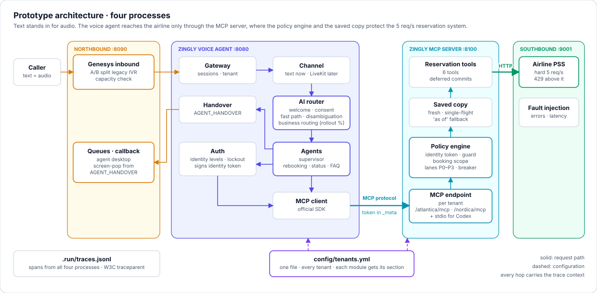
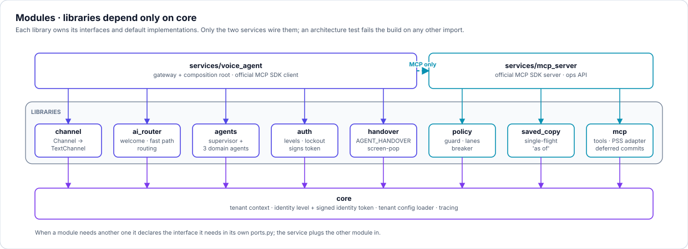
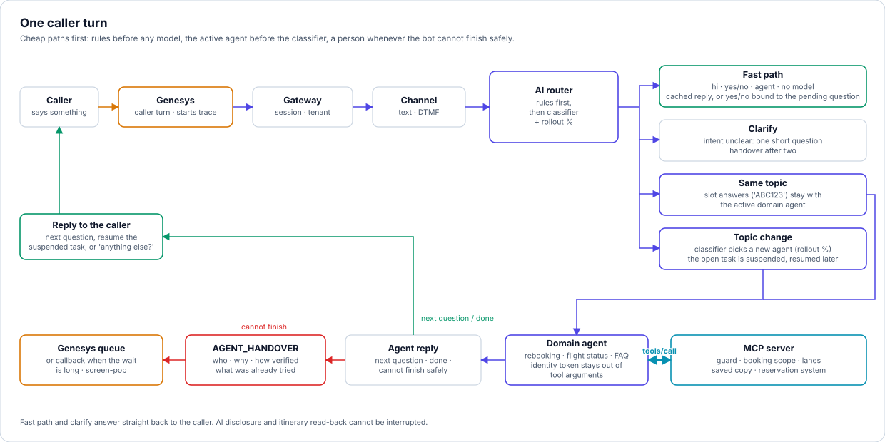
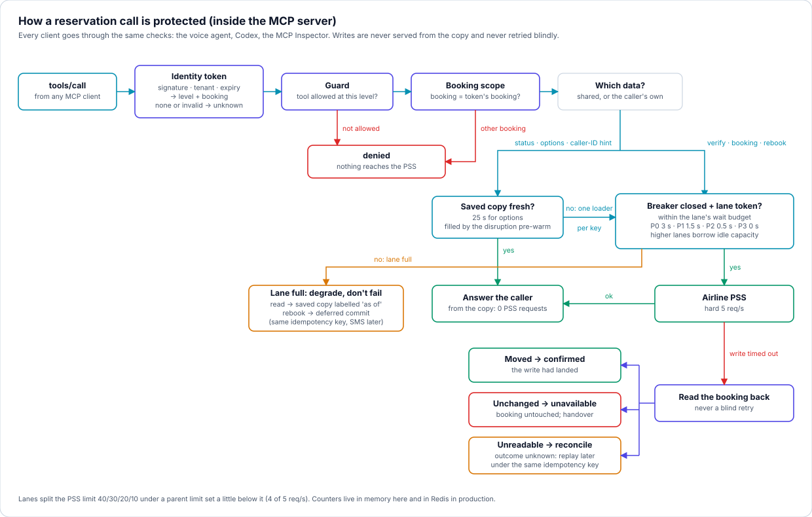
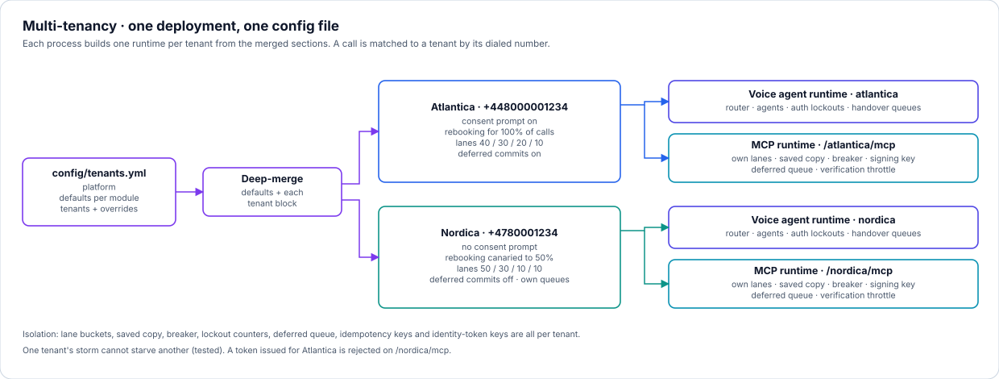

# Zingly voice agent prototype

A simulated flight-disruption call, end to end, in text. This is the slice the assignment
recommends, built on the module boundaries of the [solution design](../docs/SOLUTION_DESIGN.md):

- **Caller utterances** (text standing in for audio) arrive through a **Genesys simulator** (northbound).
- The **voice agent** identifies the caller and answers through a **real MCP server**.
- The MCP server protects a **mocked airline reservation system with a hard 5 req/s limit** (southbound).
  When the limit is near, it answers from a **saved copy** and **priority lanes**.
- Every handover produces an **`AGENT_HANDOVER` JSON payload** for the Genesys screen-pop.
- A **load script** simulates a spike. **14 runnable flows** demonstrate every degraded mode, and
  their **distributed traces** are recorded as documentation.

There is no LLM and no API key. The agents run in the design's *deterministic mode*: templates
and slot filling behind the same interfaces an LLM version would use.

## Quick start

```bash
  cd prototype
  ./start_up.sh                        # Python venv + install + start all four servers
  .venv/bin/python scripts/run_flow.py --list
  .venv/bin/python scripts/run_flow.py happy_rebooking --trace
  .venv/bin/python -m genesys_sim --trace         # interactive call in the terminal
  open http://127.0.0.1:8090                      # or the softphone + agent desktop in a browser
  .venv/bin/python scripts/spike.py              # load spike: unprotected vs protected
  ./start_up.sh stop
```

`start_up.sh` needs only Python 3.11+ on the PATH. It creates `.venv`, installs the 13 packages
in editable mode (only when a `pyproject.toml` changed), and stops whatever already listens on a port
(SIGTERM, then SIGKILL after a grace period). It then starts the servers in dependency order and
waits for each one's health check. Other commands are `stop`, `restart`, `status`, `test` and
`logs <name>`, with the options `--skip-install`, `--clean-traces` and `--reinstall`.

| Process | Port | Side | What it is |
|---|---|---|---|
| `genesys` | 8090 | northbound | Genesys inbound flow: A/B split, capacity check, queues, callback, screen-pop, browser UI |
| `voice_agent` | 8080 | Zingly | Gateway + channel + AI router + agents + auth + handover; an **MCP client** |
| `mcp` | 8100 | Zingly | **MCP server** (official SDK): `/{tenant}/mcp` + policy engine + saved copy |
| `pss` | 9001 | southbound | Airline reservation system: hard 5 req/s per airline, 429, fault injection |

## Architecture



**Why the policy engine lives inside the MCP server.** Every client of the reservation system
passes through the same door: the voice agent, Codex, or the MCP Inspector. So the guard, the
booking-scope check, the lanes and the saved copy apply to every caller, not just to well-behaved
ones. The voice agent holds no reservation code at all, and an architecture test enforces that.

## Modules

Each box above is its own library under `libs/`, with its own `pyproject.toml` and tests.
Two services compose them. The interfaces and default implementations of a module live
**inside that module**.

| Library | Design box | Interface → default implementation | Config section | Runs in |
|---|---|---|---|---|
| `core` | shared base | `TenantContext`, `IdentityLevel`, signed `identity_token`, `TenantConfigStore`, `tracing` | `platform` | both |
| `channel` | voice worker | `Channel` → `TextChannel` | `channel` | voice agent |
| `ai_router` | AI routing | `IntentClassifier` → `KeywordClassifier`, plus `AIRouter`, `FastPath`, `Welcome`, `BusinessRouter` | `ai_router` | voice agent |
| `agents` | supervisor + domain agents | `DomainAgent` → Rebooking / Flight status / FAQ, `Supervisor` | `agents` | voice agent |
| `auth` | Auth service | `AuthService` → `DefaultAuthService` (lockout, issues the token) | `auth` | voice agent |
| `handover` | handover, screen-pop | `HandoverBuilder` → `GenesysHandoverBuilder` | `handover` | voice agent |
| `policy` | policy engine | `ToolGuard` → `LevelGuard`, `AdmissionController` → `LaneAdmission`, `CircuitBreaker` → `CountingBreaker` | `policy` | MCP server |
| `saved_copy` | saved copy | `SavedCopy` → `InMemorySavedCopy` | `saved_copy` | MCP server |
| `mcp` | reservation tools | `ToolRegistry`, `PssBackend` → `HttpPssBackend`, `DeferredCommits` (transport-free) | `mcp` | MCP server |



When a module needs another one, it declares the interface it needs **in its own package**
(`ports.py`), and the service plugs the other module in. For example, `mcp` declares `AdmissionPort`
and `CachePort`, and `policy` and `saved_copy` satisfy them without importing each other.
`tests/test_architecture.py` fails the build on any other import: a library importing another
library, the MCP SDK inside a library, or the voice agent importing reservation code.

## How one caller turn is handled



## How a reservation call is protected



## Multi-tenancy: one deployment, one config file



[`config/tenants.yml`](config/tenants.yml) has three blocks:

- **`platform`**: service URLs and the trace sink, shared by every process.
- **`defaults`**: one section per module.
- **`tenants`**: each tenant's dialed numbers and overrides.

Each process builds one runtime per tenant and hands each module only its own merged section.
A call is matched to a tenant by its dialed number. Lane buckets, saved copy, breaker, lockout
counters, deferred queue, idempotency keys and identity-token keys are all per tenant. One
tenant's storm cannot starve another tenant, and that is tested.

## The MCP server

A real Model Context Protocol server built on the official `mcp` Python SDK (1.30.0):

- **Streamable HTTP**, one endpoint per tenant (`/atlantica/mcp`, `/nordica/mcp`), and **stdio**
  (`python -m mcp_server --stdio --tenant atlantica`).
- **Six tools** with input and output schemas and annotations:
  - `get_flight_status`, `get_alternatives`: public.
  - `lookup_caller_id`: masked summary only.
  - `verify_booking`: returns booking data only on a match.
  - `get_booking`, `rebook`: VERIFIED and scoped to the token's booking.
- **One resource**, `zingly://{tenant}/admission`, with live lane, saved-copy and breaker counters.
- **Identity travels out of band**, never through a tool argument: request `_meta.identity_token`,
  the `X-Identity-Token` header, or `ZINGLY_IDENTITY_TOKEN` for stdio clients.

[docs/MCP_SERVER.md](docs/MCP_SERVER.md) shows how to connect **Codex**, the **MCP Inspector**
or any MCP client.

## Demonstration flows

`scripts/run_flow.py` plays a YAML scenario from [`flows/`](flows) against the running servers.
It applies setup actions (fault injection, lane saturation, capacity, A/B split), places calls
through Genesys, checks every reply, and verifies the end state in the reservation system.
`--trace` prints the distributed trace of every turn. `--record` writes the pages in
[docs/flows/](docs/flows/README.md), built from the real spans.

| Flow | Shows |
|---|---|
| [01 happy rebooking](docs/flows/01_happy_rebooking.md) | likely → verified, side question then resume, commit in P0, signed token |
| [02 flight status, public](docs/flows/02_flight_status_public.md) | no identity needed; saved copy, 0 PSS requests, "as of" |
| [03 clarify then route](docs/flows/03_clarify_then_route.md) | ambiguous intent, one clarifying question |
| [04 verification lockout](docs/flows/04_verification_lockout.md) | three failures lock; no hint whether the reference exists |
| [05 caller asks for an agent](docs/flows/05_caller_asks_for_agent.md) | fast-path handover with full context |
| [06 consent declined](docs/flows/06_consent_declined.md) | consent first; "no" goes to a person |
| [07 PSS down](docs/flows/07_pss_down_handover.md) | safe failure, no attempt used up, callback offered |
| [08 PSS brownout](docs/flows/08_pss_brownout_saved_copy.md) | saved copy "as of", read-before-retry, idempotent reconciliation |
| [09 deferred commit](docs/flows/09_deferred_commit.md) | P0 saturated → deferred commit, confirmed later |
| [10 breaker opens](docs/flows/10_breaker_open_capacity.md) | breaker open → Genesys capacity check → person |
| [11 capacity full](docs/flows/11_capacity_full.md) | session ceiling → overflow to the human queue |
| [12 second tenant](docs/flows/12_second_tenant_nordica.md) | same deployment, Nordica config, rollout canary |
| [13 A/B split](docs/flows/13_ab_split_legacy_ivr.md) | Genesys sends the call to the legacy IVR |
| [14 MCP client direct](docs/flows/14_mcp_direct_client.md) | MCP protocol, guard, booking scope, idempotent write |

## Testing the gaps: spike, handover, degraded modes

[docs/TESTING_GAPS.md](docs/TESTING_GAPS.md) maps each risk in the design to the command
that demonstrates it, what to look for, and where it shows up in the trace.

The spike (`scripts/spike.py`) places 120 callers from the cancelled flight AT123 at 6 new calls
per second, 40% of whom rebook, against the 5 req/s reservation system. All traffic goes through
the real MCP protocol. Numbers vary a little from run to run.

| | Protection off | Protection on |
|---|---:|---:|
| PSS requests sent | 221 | 80 (3 of them the pre-warm) |
| **PSS 429 rejections** | **126** | **0** |
| PSS requests per call | 1.84 (low only because most calls failed early) | 0.67 |
| PSS peak accepted req/s | 5 (at the limit) | 4 (parent limit) |
| Callers rebooked | 5 | 50 (38 live + 12 deferred, all 12 confirmed) |
| Handed over because a backend call failed | 85 | 0 |
| Flight-status callers answered | 30 of 70 | 70 of 70 |
| Saved-copy hits | 0 | 220 |

## Tracing

Every process writes spans to `.run/traces.jsonl`. Context crosses process boundaries with
the W3C `traceparent` header, or in MCP `_meta`. So one caller turn is one trace through Genesys →
voice agent → MCP server → PSS. Use `scripts/trace.py` to read traces, the browser agent desktop
to see the trace of the last turn, or [docs/TRACING.md](docs/TRACING.md) for the span catalogue
and how each flow is executed component by component.

## Automated tests

`./start_up.sh test` runs **56 tests**:

- unit tests per library;
- MCP-server tests over the real protocol;
- end-to-end voice-agent tests, in which the voice agent talks MCP to the MCP server, which talks HTTP to the PSS, all in one process;
- architecture rules.

The flows above are the live, demonstrable counterpart.

## Production readiness

[docs/PRODUCTION_READINESS.md](docs/PRODUCTION_READINESS.md) lists, area by area, what is
simulated here and what must be built or enabled before going live.

## Layout

The diagrams above are SVGs generated by `python docs/diagrams/build_diagrams.py` (standard library only),
with the same toolkit and style as the solution-design figures.

```
prototype/
  start_up.sh                    set up + start/stop everything
  config/tenants.yml             one file, all tenants
  libs/<module>/                 9 libraries: src/zingly_<module>/, tests/, pyproject.toml
  services/voice_agent/          gateway + composition root, MCP client
  services/mcp_server/           MCP server (SDK) + composition root, ops API
  sims/northbound/               Genesys simulator: server, CLI, browser UI, genesys.yml
  sims/southbound/               airline reservation system (rate limited, fault injection)
  flows/                         14 runnable demonstration flows (YAML)
  scripts/                       run_flow.py, record_flow.py, spike.py, trace.py, mint_identity_token.py
  docs/                          MCP server, testing the gaps, tracing, production readiness, recorded flows
  tests/                         architecture rules
  conftest.py                    in-process harness for the end-to-end tests
```
