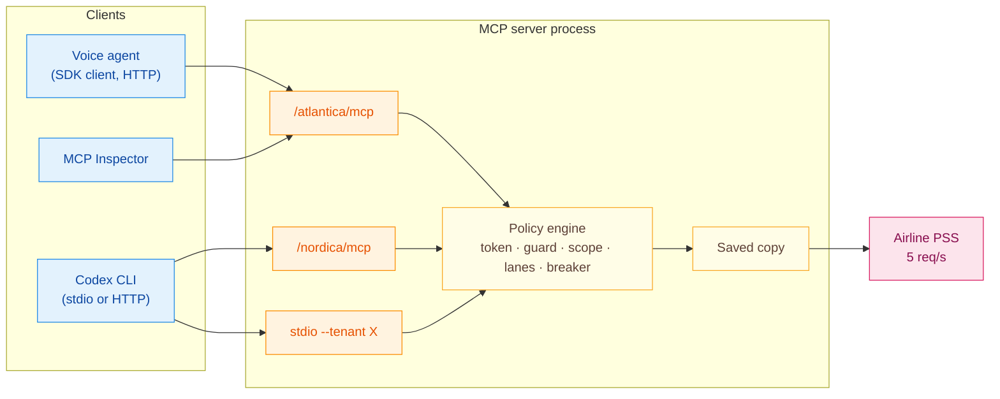

# The Zingly MCP server

The MCP server is the one door from Zingly to the airline's systems. It is a real
[Model Context Protocol](https://modelcontextprotocol.io) server built on the official Python SDK
(`mcp` 1.30.0, FastMCP). Any MCP client can use it, not just the voice agent: Codex, Claude
Desktop, the MCP Inspector or your own script.



## Transports

| Transport | How | Tenant |
|---|---|---|
| Streamable HTTP | started by `./start_up.sh` on `:8100`, stateless, JSON responses | from the path: `http://127.0.0.1:8100/atlantica/mcp`, `/nordica/mcp` |
| stdio | `python -m mcp_server --stdio --tenant atlantica` | from `--tenant` (or `ZINGLY_TENANT`) |

DNS-rebinding protection is on. Only `127.0.0.1` and `localhost` hosts and origins are accepted.
Both transports need the mock reservation system running on `:9001` (`./start_up.sh` starts it).

## Tools

Every tool returns the same structured envelope, published as the tool's `outputSchema`:

```json
{ "status": "ok | stale | deferred | denied | not_found | conflict | unavailable",
  "data": {}, "source": "pss | saved_copy | coalesced | none", "as_of": 1760000000.0, "detail": "" }
```

| Tool | Arguments | Needs | Lane | Notes |
|---|---|---|---|---|
| `get_flight_status` | `flight` | nothing | P3 | Shared data: saved copy first, single-flight on a miss |
| `get_alternatives` | `origin`, `destination` | nothing | P2 | Saved copy fresh for 25 s, then one loader per route |
| `lookup_caller_id` | `phone` | nothing | P1 | **Masked only**: `[{flight, ref_masked}]`, never booking data |
| `verify_booking` | `booking_ref`, `surname` | nothing | P1 | Booking only on a match; the same `{match: false}` whether the reference is wrong or the surname is |
| `get_booking` | `booking_ref` | VERIFIED token **for that booking** | P1 | Live first, saved copy as the "as of" fallback |
| `rebook` | `booking_ref`, `from_flight`, `to_flight` | VERIFIED token **for that booking** | P0 | Idempotent key `hash(tenant, booking, from, to)`; `deferred` when P0 is saturated; reconciles when a timed-out write cannot be read back |

There is also one resource: `zingly://{tenant}/admission`, with live lane, saved-copy, breaker and
deferred-commit counters.

## Identity: never a tool argument

The Auth service in the voice agent signs a short-lived identity token after it verifies a
caller: `{tenant, conversation, level, booking_ref, exp}`, HMAC-SHA256 with a per-tenant key. The MCP
server only trusts a level carried by a valid token. The booking-scoped tools act only on the booking
named in it. A model therefore cannot claim a level or touch someone else's booking, and the token is
not in any tool schema. The server reads it from, in order:

1. request `_meta.identity_token` (what the voice agent sends, with `_meta.traceparent`),
2. the `X-Identity-Token` HTTP header (any Streamable HTTP client),
3. the `ZINGLY_IDENTITY_TOKEN` environment variable (stdio clients such as Codex).

To test by hand, mint a token with the same dev key:

```bash
.venv/bin/python scripts/mint_identity_token.py --tenant atlantica --booking ABC123
```

The keys come from `ZINGLY_IDENTITY_KEY_<TENANT>`. When it is unset, a fixed dev key is used:
fine for the prototype, never for production.

## Connect Codex

Start the services first (`./start_up.sh`). Then add the server to `~/.codex/config.toml`.
Replace `/path/to` with the absolute path of your clone.

**stdio** (works in every Codex version that supports MCP):

```toml
[mcp_servers.zingly_atlantica]
command = "/path/to/assignment_zingly/prototype/.venv/bin/python"
args = ["-m", "mcp_server", "--stdio", "--tenant", "atlantica"]
env = { "ZINGLY_TENANTS_CONFIG" = "/path/to/assignment_zingly/prototype/config/tenants.yml" }
# To let Codex rebook ABC123, add a VERIFIED token scoped to it:
# env = { ..., "ZINGLY_IDENTITY_TOKEN" = "<output of scripts/mint_identity_token.py --booking ABC123>" }
```

**Streamable HTTP** (Codex versions with remote MCP support):

```toml
[mcp_servers.zingly_atlantica_http]
url = "http://127.0.0.1:8100/atlantica/mcp"
# http_headers = { "X-Identity-Token" = "<token>" }
```

Or use the CLI: `codex mcp add zingly_atlantica -- /path/to/.venv/bin/python -m mcp_server --stdio --tenant atlantica`.

Then try these prompts in Codex:

- "What is the status of flight AT123?" → `get_flight_status`
- "Which flights can I take from LHR to BOS instead?" → `get_alternatives`
- "Check booking ABC123 for surname Jones" → `verify_booking` returns `match: false`, with no hint which part was wrong
- "Rebook ABC123 from AT123 to AT127" → `denied` without a token. With the token in `env`, `ok`. Ask again and the
  response is the same confirmation with `replayed: true` (idempotent).
- "Read the zingly://atlantica/admission resource" → live lane counters

A stdio server is its own process, so it has its own lane buckets and saved copy. In production
those live in Redis and every instance shares them (see [PRODUCTION_READINESS.md](PRODUCTION_READINESS.md)).

## Connect the MCP Inspector

```bash
npx @modelcontextprotocol/inspector
# Transport: Streamable HTTP · URL: http://127.0.0.1:8100/atlantica/mcp
# For booking tools add the header X-Identity-Token: <token>
```

## From Python (the official SDK)

```python
import asyncio, httpx
from mcp import ClientSession
from mcp.client.streamable_http import streamable_http_client

async def main():
    async with httpx.AsyncClient() as http:
        async with streamable_http_client("http://127.0.0.1:8100/atlantica/mcp", http_client=http) as (r, w, _):
            async with ClientSession(r, w) as s:
                await s.initialize()
                print([t.name for t in (await s.list_tools()).tools])
                res = await s.call_tool("get_flight_status", {"flight": "AT123"})
                print(res.structuredContent)

asyncio.run(main())
```

Flow [14](flows/14_mcp_direct_client.md) runs exactly this kind of session, covering the guard, booking
scope and idempotency, and records its trace.

## Ops API (same process)

| Method | Path | Purpose |
|---|---|---|
| `GET` | `/health` | Endpoints per tenant |
| `GET` | `/admin/stats` | Per-tenant lanes, saved copy, breaker, deferred commits, tool results |
| `GET` | `/admin/{tenant}/health` | Breaker state, read by the voice agent's capacity check |
| `POST` | `/admin/{tenant}/prewarm` | Disruption event: load status, passenger list and options once |
| `POST` | `/admin/{tenant}/lanes/pause` | Demo: treat lanes as saturated for N seconds |
| `POST` | `/admin/{tenant}/protection` | Demo: lanes and saved copy off |
| `POST` | `/admin/{tenant}/reset` | Fresh lanes, saved copy, breaker and deferred queue |
