# Production readiness: simulated here, required for production

A re-review of the prototype against the solution design, area by area. Each row says what the
prototype does today, what production needs, and when it must be in place:

- **Pilot**: before the first real caller.
- **GA**: before full rollout.
- **Later**: an improvement.

The module boundaries and interfaces are meant to stay. Most rows swap a default implementation
behind an interface that already exists.

```mermaid
flowchart LR
    subgraph Keep["Keeps its shape"]
        k1["Module boundaries + interfaces"]:::keep
        k2["Tool contracts + output envelope"]:::keep
        k3["AGENT_HANDOVER payload"]:::keep
        k4["Span names + attributes"]:::keep
        k5["Tenant config layout"]:::keep
    end
    subgraph Swap["Swap the implementation"]
        s1["TextChannel → LiveKit participant"]:::swap
        s2["Keyword classifier, templates → LLM via AI gateway"]:::swap
        s3["In-memory state → Redis + durable queue"]:::swap
        s4["HMAC dev keys → KMS asymmetric keys"]:::swap
        s5["Custom tracer → OpenTelemetry"]:::swap
        s6["Mock PSS → real PSS adapter"]:::swap
    end
    subgraph Add["Add"]
        a1["AuthN on every endpoint"]:::add
        a2["Strongly verified (app push, SMS code)"]:::add
        a3["Metrics, SLOs, alerts"]:::add
        a4["CI/CD, containers, autoscaling"]:::add
        a5["Retention + DPIA controls"]:::add
    end
    Keep --> Swap --> Add
    classDef keep fill:#E8F5E9,stroke:#43A047,color:#1B5E20
    classDef swap fill:#FFF3E0,stroke:#FB8C00,color:#E65100
    classDef add fill:#FCE4EC,stroke:#D81B60,color:#880E4F
```

## 1. Security: the gaps to close first

| Area | Prototype today | Production | When |
|---|---|---|---|
| Gateway endpoints (Genesys → Zingly) | Unauthenticated | OAuth 2.0 client credentials (5-minute tokens), WAF, IP allow-list for Genesys egress | Pilot |
| MCP server endpoints | Unauthenticated; the tenant is taken from the URL path | MCP authorization (OAuth 2.1 resource server, audience-bound tokens) or mTLS in a service mesh. The tenant comes from the token's claims and must match the path. Allow only the voice agent; Codex and the Inspector only in dev | Pilot |
| Admin and demo endpoints (`/v1/admin/*`, `/admin/*`, protection switch, lane pause, reset, PSS fault injection) | Open, for demos | **Removed** from production builds, or on an internal port behind ops authentication. The protection switch must not exist | Pilot |
| Identity token | HMAC-SHA256, per-tenant keys from env vars, fixed dev key when unset, 15-minute expiry | Asymmetric signing (ES256) with keys in KMS, a `kid` header and rotation, `iss`/`aud` claims, expiry under 2 minutes refreshed per turn, `jti` replay cache. Startup fails if no key is configured | Pilot |
| Handover context (Data Action endpoint) | Unauthenticated, tenant check only | Genesys Data Action with OAuth, scoped per tenant; context expires after 24 hours | Pilot |
| Disruption webhook | HMAC over the body when a secret is configured | HMAC plus timestamp and replay window, per-tenant secret in a vault, mandatory | Pilot |
| Guessing at verification | Lockout per caller number (Auth) **and** a per-booking throttle in the MCP server (5 failures in 15 minutes, whoever asks) | Same rules, with counters in Redis; alerting on enumeration patterns across bookings | Pilot |
| Strongly verified level | Defined, not reachable | App push approval (OIDC) or SMS one-time code; required for split bookings, minors and refunds | GA |
| Secrets | Environment variables | Vault or cloud secret manager, per-tenant credentials for the PSS | Pilot |
| Prompt injection (once there is an LLM) | Not applicable (deterministic) | Tool allow-list per identity level (exists); the identity token stays out of tool arguments (exists); output checks so that times, flights and entitlements are quoted only from tool results | GA |

## 2. Voice and telephony

| Area | Prototype | Production | When |
|---|---|---|---|
| Channel | `TextChannel`: text in and out | LiveKit room participant behind the same `Channel` interface: SIP over TLS with SRTP from Genesys, streaming STT and TTS, DTMF | Pilot |
| Welcome and consent audio | `audio_id` returned, no audio | Pre-rendered per tenant and version in object storage or a CDN; the AI disclosure cannot be interrupted | Pilot |
| Barge-in | Not testable | 200 ms of speech plus an STT partial stops TTS and trims the bot's turn to what was heard; tested with recorded audio | Pilot |
| STT or TTS outage | Not testable | Secondary vendor within 2 s, then keypad mode or cached phrases; synthetic calls every minute per vendor | GA |
| Latency budget | Text turns of 1–300 ms; lanes wait up to 3 s | End-of-speech to first audio p95 under 1.2 s; filler phrases while waiting on a lane; measured per turn | Pilot |

## 3. AI layer

| Area | Prototype | Production | When |
|---|---|---|---|
| Classifier | `KeywordClassifier` | Small LLM classifier behind `IntentClassifier` (domain, intent, confidence, clarify) through the AI gateway | Pilot |
| Domain agents | Deterministic templates and slot filling | LLM agents behind `DomainAgent`, with the `stay / switch / clarify` decision field; the deterministic agents remain as the fallback mode | Pilot |
| LLM routing | None | AI gateway with EU-region OpenAI and Anthropic deployments, a hedge to a secondary model at 600 ms, deterministic mode on outage, PII tokenised before the model | Pilot |
| Evaluation | 14 flows and 56 tests | The flows become the seed of an evaluation set: golden conversations replayed on every model or prompt change, with containment, handover-reason and wording checks | GA |

## 4. State, scale and data

| Area | Prototype | Production | When |
|---|---|---|---|
| Lanes and parent limit | In memory, per process and tenant | Redis token buckets (Lua script, atomic), shared by every MCP server instance; the parent limit set per tenant from the airline's contract | Pilot |
| Saved copy and single-flight | In memory, per process | Redis with TTLs and `SET NX PX` lock keys, encrypted per tenant; the stdio MCP server then shares the same state | Pilot |
| Deferred commits and reconciliation | In-memory queue drained every 2 s | Durable queue (SQS or Kafka) with an outbox, retries with backoff, dead-letter queue and alerts on age; the SMS confirmation sent by a provider and recorded | Pilot |
| Idempotency | Keys held by the mock PSS | The PSS's own idempotency support, or a Zingly idempotency store with 24-hour retention | Pilot |
| Sessions and lockouts | In memory, idle expiry after 30 minutes | Session store with TTL (Redis); a global active-session counter for the capacity check; lockouts in Redis | Pilot |
| Horizontal scale | One process per service | Stateless pods behind load balancers; predictive autoscaling on the disruption event; reserved capacity with speech and LLM vendors | GA |
| MCP client overhead | A new MCP session per tool call (about 30 ms) | A session pool per tenant, or a stateful Streamable HTTP session per conversation | GA |

## 5. Reservation system integration

| Area | Prototype | Production | When |
|---|---|---|---|
| PSS | Mock over HTTP with a hard 5 req/s limit | Real adapter behind `PssBackend` (NDC, EDIFACT or REST), mTLS, per-tenant credentials, honouring `Retry-After` | Pilot |
| Hold and commit | One `rebookings` call | Separate hold and commit steps; release the hold when the commit fails | Pilot |
| Eligibility | The mock checks seat availability only | Involuntary re-accommodation rules (cabin, fare basis, partner flights) from the airline's policy service, never from the model | Pilot |
| Disruption feed | Manual webhook call | The airline's signed event feed, triggering pre-warm automatically; backfill on reconnect | Pilot |

## 6. Genesys

| Area | Prototype | Production | When |
|---|---|---|---|
| Inbound flow, A/B split, capacity check | `genesys_sim` | Architect inbound flow calling the gateway's capacity check and create endpoints, with an error path to the human queue | Pilot |
| Screen-pop | Simulator UI | Agent desktop script reading the `zingly.*` participant attributes, plus a Data Action for the full context | Pilot |
| Callback | Decision in the simulator (wait above 120 s) | Genesys callback API keeping the caller's place, with the same attributes | Pilot |

## 7. Observability and operations

| Area | Prototype | Production | When |
|---|---|---|---|
| Traces | Custom W3C-compatible tracer writing to a shared JSON-lines file | OpenTelemetry SDK with the same span names, OTLP to a collector, sampling (every error trace, a share of the rest), PII scrubbing processor | Pilot |
| Metrics | Counters behind `/admin/stats` | Prometheus metrics: lane admitted and rejected by lane, PSS 429s (target 0), saved-copy hit ratio, deferred backlog and age, handover rate by subcategory, containment, verification failure rate, p95 turn latency | Pilot |
| Alerts and SLOs | None | PSS 429 above 0; deferred commit older than 15 minutes; breaker open; handover rate jump; p95 latency | Pilot |
| Logs | uvicorn warnings | Structured JSON with trace ids; audit log of every tool call (the registry's audit list today) to the SIEM | Pilot |
| Runbooks and chaos | The flows in [TESTING_GAPS.md](TESTING_GAPS.md) | The same scenarios as scheduled chaos tests in staging against a PSS sandbox | GA |

## 8. Configuration and delivery

| Area | Prototype | Production | When |
|---|---|---|---|
| Tenant config | One YAML file, loaded at start | Versioned per-tenant config (GitOps or a config service), schema-validated in CI and at startup, hot reload with canary, audit of who changed what | Pilot |
| Build and deploy | `start_up.sh`, editable installs | Container image per service, CI (lint, type check, unit tests, architecture tests, flows as smoke tests against staging), blue/green deploys | Pilot |
| Load testing | `scripts/spike.py`, local | The same scenario at 20x in staging against a rate-limited PSS sandbox, before each release | GA |

## 9. Data protection and compliance

| Area | Prototype | Production | When |
|---|---|---|---|
| Retention | Everything in memory until restart; traces in a local file | Redacted transcripts 30 days, handover context 24 hours, no audio, traces without PII and retained briefly | Pilot |
| Residency | Local | EU-only platform, including the model deployments; DPA with Standard Contractual Clauses and a transfer-impact assessment | Pilot |
| DPIA, consent | Consent prompt and decline path exist | DPIA signed off before go-live; consent recorded with the call; right of erasure across stores | Pilot |
| Business sign-off | Deferred commit wording and the 30-minute promise | Signed off by the airline before it is used with callers | Pilot |
