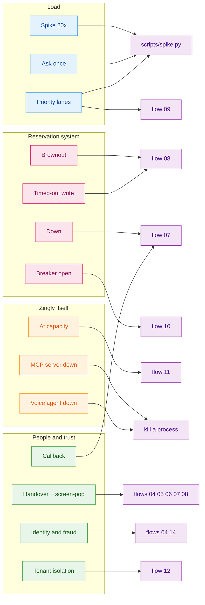

# Testing the gaps: spike, handover and every degraded mode

This page maps each risk the solution design addresses to the command that demonstrates it on
the running prototype, what to look for, and where it shows up in the trace. Start everything
with `./start_up.sh` first. Each flow resets state, applies its own faults, and restores normal
mode at the end.



## Load: the 20x spike

| Risk | Run | What you should see | In the trace |
|---|---|---|---|
| Spike overloads the 5 req/s reservation system | `.venv/bin/python scripts/spike.py` | Unprotected: over 100 × 429 and most callers handed over. Protected: **0 × 429**, peak 4 req/s, every caller served | `policy.admission admitted=False` then the fallback; `saved_copy.get_or_load source=fresh` |
| Pre-warm matters | `scripts/spike.py --mode protected --no-prewarm` | Still 0 × 429. Every caller-ID and booking lookup now competes for P1, and about a quarter of callers are handed over with `verification_unavailable`. Pre-warm removes that | `pss.request` on every `lookup_caller_id` |
| "Ask once" (single-flight) | `.venv/bin/python -m pytest libs/saved_copy` | 50 concurrent misses on one key → **1** origin load, 49 `coalesced` | `saved_copy.get_or_load source=coalesced` |
| Priority lanes and borrowing | spike output, `lanes:` line | `P0.borrowed_from_P2` (idle lanes lend upward), `P1.rejected` (fallbacks), never `P3.borrowed_from_P0` | `policy.admission lane=P0 waited_ms=…` |
| Bigger spike | `scripts/spike.py --calls 300 --rate 12` | Still 0 × 429; more deferred commits and "as of" answers | |

Example run (120 callers at 6 per second, 40% rebooking):

| | Protection off | Protection on | Protection on, no pre-warm |
|---|---:|---:|---:|
| PSS 429 rejections | 126 | **0** | **0** |
| Callers rebooked | 5 | 50 (12 deferred, all confirmed) | 23 |
| Handed over because a backend call failed | 85 | 0 | 27 |
| Flight-status callers answered | 30 of 70 | 70 of 70 | 70 of 70 |

## Lane fallbacks, one by one

| Lane full | Run | What the caller hears |
|---|---|---|
| P0 book or hold | `scripts/run_flow.py 09` | "I've noted your choice of AT131 at 19:40 … a text within 30 minutes." The commit lands later under the same idempotency key, and the flow checks the PSS |
| P1 find the booking | `scripts/run_flow.py 08` | Verified against the pre-warmed passenger list; the handover notes "booking checked against saved copy as of HH:MM" |
| P2 refresh options | flow 08, or let options age past 25 s during a brownout | "… Availability changes quickly, so I'll check before I book." |
| P3 flight status | `scripts/run_flow.py 02` | "AT123 to Boston is cancelled. That's as of HH:MM." with 0 PSS requests |

To saturate a lane by hand: `curl -XPOST localhost:8100/admin/atlantica/lanes/pause -d '{"lanes":["P1"],"seconds":20}' -H 'content-type: application/json'`

## The reservation system misbehaves

| Risk | Run | What you should see |
|---|---|---|
| Brownout (slow) | `scripts/run_flow.py 08 --trace` | Verification and options from the saved copy, labelled "as of". The commit times out and so does the read-back, so the bot **does not claim either way**: `rebook_unconfirmed` handover, and a reconciliation queued under the same key that confirms **exactly once** when the PSS recovers |
| Down (errors) | `scripts/run_flow.py 07` | No attempt is used up; `verification_unavailable` handover; **callback offered** because the queue wait is above 120 s |
| Repeated failures | `scripts/run_flow.py 10` | After 5 failures the MCP server's breaker opens. The next caller is routed to a person **by the Genesys capacity check**, before reaching the bot |
| Your own fault mix | `curl -XPOST localhost:9001/admin/mode -H 'content-type: application/json' -d '{"airline":"atlantica","error_rate":0.3,"extra_latency_ms":800}'` and then call with `python -m genesys_sim --trace` | Mixed answers, some "as of", traces with `✗` spans |

## Zingly itself fails

| Risk | Run | What you should see |
|---|---|---|
| At capacity | `scripts/run_flow.py 11` | The second call is refused by the capacity check and queued for a person |
| MCP server down | `kill $(cat .run/mcp.pid)` then `python -m genesys_sim` | Genesys: "capacity check: mcp_server_unreachable", human queue. Mid-call, tool calls come back `unavailable` and the agent hands over. Restart with `./start_up.sh --skip-install` |
| Voice agent down | `kill $(cat .run/voice_agent.pid)` then `python -m genesys_sim` | Genesys: "capacity check: zingly_unreachable", human queue. **Never a dropped call** |
| Bot share rolled back | `scripts/run_flow.py 13` | The Genesys A/B split sends calls to the legacy IVR without touching Zingly |

## Handover, screen-pop and callback

| Check | Run | What you should see |
|---|---|---|
| Who, why, what was tried | `scripts/run_flow.py 05` or `08` | `AGENT_HANDOVER` with category and subcategory, identity level and method, masked booking, disruption, every attempted action with its result, data notes |
| Masked attributes, full context by Data Action | flow 05, then `curl "localhost:8080/v1/handover-context/<context_ref>?tenant_id=atlantica"` | Genesys attributes carry only masked values; the full booking comes from the Data Action endpoint, and only for the same tenant |
| Callback on a long wait | flows 07 and 08 (`Disruption_Rebooking` wait 300 s > 120 s) | `disposition: callback_offered`; shorter queues give `queued` |
| See it as an agent would | open `http://127.0.0.1:8090`, dial, say "agent" | Agent desktop panel with the screen-pop, and the trace of the last turn |

## Identity and fraud

| Check | Run | What you should see |
|---|---|---|
| Lockout after 3 failures, no existence leak | `scripts/run_flow.py 04` | A wrong reference and a wrong surname get the same reply; the third failure locks and hands over as `unknown` |
| A model or client cannot fake a level | `scripts/run_flow.py 14` | `rebook` denied without a token, denied with a token for another booking, allowed with a VERIFIED token for this booking, idempotent replay |
| Tokens are per tenant | `.venv/bin/python -m pytest services/mcp_server` | An Atlantica token is rejected on `/nordica/mcp` (bad signature); a forged token is rejected |

## Multi-tenancy

| Check | Run | What you should see |
|---|---|---|
| One deployment, per-tenant behaviour | `scripts/run_flow.py 12` | Nordica welcome, no consent prompt, Nordica airports and backend; rebooking canaried to 50% |
| One tenant's storm does not starve another | `.venv/bin/python -m pytest services/voice_agent -k starve` | Atlantica lanes saturated, Nordica answered normally |

## Not testable in this prototype

These belong to the voice layer or the LLM layer, which the prototype replaces with text and
deterministic mode. [PRODUCTION_READINESS.md](PRODUCTION_READINESS.md) says how to test them there.

| Design item | Why not here |
|---|---|
| Barge-in (200 ms of speech plus a partial transcript) | Needs audio and a LiveKit room |
| Speech-to-text or text-to-speech outage, keypad fallback | No speech vendors; the `Channel` already accepts `{"dtmf": "1"}` |
| LLM latency hedge at 600 ms, LLM outage | No LLM; the prototype *is* the deterministic fallback mode |
| Predictive autoscaling | Single process per service |

## Run everything

```bash
./start_up.sh restart --clean-traces                 # fresh servers, empty trace file
./start_up.sh test                                   # automated tests
./start_up.sh flows                                  # 14 live flows, PASS/FAIL (= scripts/run_flow.py --all)
./start_up.sh flows --all --record                   # and regenerate docs/flows/
.venv/bin/python scripts/spike.py                    # load comparison
```
