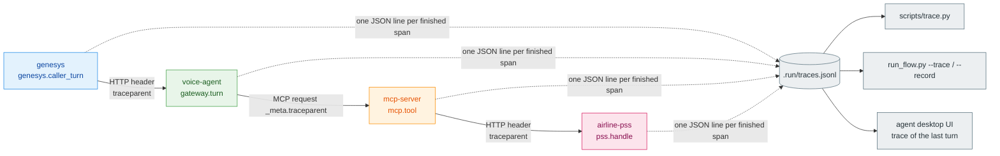

# Tracing: how each flow runs, component by component

Every process records what it does as spans, and one caller turn is **one trace** through all four
processes. This page explains the trace model, lists every span the prototype emits, and shows how to
read a trace. The recorded flows in [docs/flows/](flows/README.md) then show, for each scenario, the
exact path the call took: a sequence diagram and span trees generated from a real run.

## Model



- **Span record:** `trace_id`, `span_id`, `parent_id`, `service` (process), `component` (module),
  `name`, `start`, `duration_ms`, `status` (`ok` or `error`), and `attrs`.
- **Propagation:** W3C `traceparent` (`00-<trace>-<span>-01`). It travels in an HTTP header between
  processes, and in the request `_meta` on MCP calls, because MCP is the protocol boundary.
- **Collector:** `ZINGLY_TRACE_FILE` (default `.run/traces.jsonl`). `start_up.sh` points every
  process at the same file.
- **No PII in spans:** caller numbers and booking references are masked (`**********001`, `****23`).
  Surnames and full references never appear.
- **Production:** the same span names and attributes map one to one onto OpenTelemetry spans
  exported over OTLP. See [PRODUCTION_READINESS.md](PRODUCTION_READINESS.md).

## Span catalogue

| Process | Component | Span | When | Key attributes |
|---|---|---|---|---|
| `genesys` | genesys | `genesys.inbound_flow` | a call arrives | `routed_to` (zingly / human_queue / legacy_ivr), `reason` |
| `genesys` | genesys | `genesys.caller_turn` | every caller utterance | `status` of the call afterwards |
| `genesys` | genesys | `genesys.route_to_agent` | the bot hands over | `queue`, `wait_s`, `disposition` (queued / callback_offered) |
| `voice-agent` | gateway | `gateway.capacity_check` | Genesys asks before routing | `accept`, `active`, `limit`, `breaker`, `reasons` |
| `voice-agent` | gateway | `gateway.create_conversation` | conversation created | `conversation_id`, `audio_id` (pre-rendered welcome), `replayed` |
| `voice-agent` | gateway | `gateway.turn` | each turn | `turn`, `path`, `agent`, `identity`, `status` |
| `voice-agent` | gateway | `gateway.disruption_event` | airline disruption webhook | `flight` |
| `voice-agent` | channel | `channel.inbound` | normalise text or DTMF | `kind`, `chars` |
| `voice-agent` | ai-router | `ai_router.welcome` | call start | |
| `voice-agent` | ai-router | `ai_router.route` | every turn | `kind` (say / dispatch / handover / end), `path` (fast_path / same_topic / topic_change / clarify), `agent`, `pending`, `yes_no` |
| `voice-agent` | agents | `agents.handle` | the supervisor runs a domain agent | `agent`, `pending`, `next_question`, `done`, `resumed`, `handover`, `identity` |
| `voice-agent` | auth | `auth.caller_id_hint` | first rebooking turn | `level` (likely / unknown) |
| `voice-agent` | auth | `auth.verify` | reference + surname given | `outcome` (verified / failed / locked / unavailable), `attempts_left` |
| `voice-agent` | mcp-client | `mcp.call_tool` | every MCP `tools/call` | `tool`, `identity` (token / none), `status`, `source` |
| `voice-agent` | handover | `handover.build` | handover | `category`, `subcategory`, `queue`, `attempted_actions` |
| `mcp-server` | mcp-server | `mcp.tool` | a tool runs | `tool`, `level` (from the token), `status`, `source`, `detail` |
| `mcp-server` | policy | `policy.guard` | before every tool | `allowed`, `reason` |
| `mcp-server` | policy | `policy.admission` | before every PSS request | `lane`, `wait_budget_s`, `admitted`, `waited_ms` |
| `mcp-server` | saved-copy | `saved_copy.get_or_load` | shared reads | `source` (fresh / origin / coalesced / stale / miss), `error` |
| `mcp-server` | pss-adapter | `pss.request` | outbound HTTP to the PSS | `operation`, `http_status`, `error` |
| `mcp-server` | mcp-server | `mcp.prewarm`, `mcp.drain_deferred`, `mcp.deferred_commit` | background work | `flight`, `outcome`, `attempt` |
| `airline-pss` | airline-pss | `pss.handle` | the reservation system answers | `resource`, `http_status` (**429** when the hard limit is hit), `limit_rps` |

## Reading a trace

`python -m genesys_sim --trace`, `scripts/run_flow.py <flow> --trace` and `scripts/trace.py` all
print the same tree. The process is in brackets, then the component, the span, its duration and its
attributes. A `✗` marks an error span. This is the "Smith" turn of a rebooking call, where the caller
becomes verified:

```text
[genesys] genesys: genesys.caller_turn (192.2 ms) status=IN_PROGRESS
  [voice-agent] gateway: gateway.turn (188.4 ms) turn=4 path=same_topic agent=rebooking identity=verified
    [voice-agent] channel: channel.inbound (0.0 ms) kind=speech chars=5
    [voice-agent] ai-router: ai_router.route (0.1 ms) active=rebooking pending=surname kind=dispatch path=same_topic
    [voice-agent] agents: agents.handle (187.9 ms) agent=rebooking pending=surname next_question=choose_option identity=verified
      [voice-agent] auth: auth.verify (121.3 ms) booking=****23 outcome=verified level=verified
        [voice-agent] mcp-client: mcp.call_tool (121.0 ms) tool=verify_booking status=ok source=pss
          [mcp-server] mcp-server: mcp.tool (85.8 ms) tool=verify_booking level=unknown status=ok source=pss
            [mcp-server] policy: policy.guard (0.0 ms) tool=verify_booking allowed=True
            [mcp-server] policy: policy.admission (0.0 ms) lane=P1 wait_budget_s=1.5 admitted=True waited_ms=0.0
            [mcp-server] pss-adapter: pss.request (85.2 ms) operation=get_booking http_status=200
              [airline-pss] airline-pss: pss.handle (81.5 ms) resource=bookings http_status=200 limit_rps=5
      [voice-agent] mcp-client: mcp.call_tool (32.1 ms) tool=get_flight_status status=ok source=saved_copy
        [mcp-server] mcp-server: mcp.tool (0.3 ms) tool=get_flight_status status=ok source=saved_copy
          [mcp-server] policy: policy.guard (0.0 ms) tool=get_flight_status allowed=True
          [mcp-server] saved-copy: saved_copy.get_or_load (0.0 ms) key=flight source=fresh
      [voice-agent] mcp-client: mcp.call_tool (33.7 ms) tool=get_alternatives status=ok source=saved_copy
        [mcp-server] mcp-server: mcp.tool (0.3 ms) tool=get_alternatives status=ok source=saved_copy
          [mcp-server] policy: policy.guard (0.0 ms) tool=get_alternatives allowed=True
          [mcp-server] saved-copy: saved_copy.get_or_load (0.0 ms) key=alts source=fresh
```

What it tells you:

- **Path:** Genesys → gateway → router (same topic, a slot answer) → rebooking agent → auth → MCP.
- **Only one PSS request:** the verification went live in lane P1, without waiting. Flight status and
  options came from the saved copy (`source=fresh`), with no lane and no PSS request.
- **Where the time went:** about 85 ms in the PSS. Each `mcp.call_tool` adds about 30 ms of client
  overhead, because the client opens a new MCP session for every call; pooling sessions would remove that.
- **The guard:** it ran before every tool, at level `unknown`. Verification is the call that grants the level.

## How each kind of flow runs

The recorded pages hold the real diagrams. In summary:

| Flow type | Components, in order | Distinctive spans |
|---|---|---|
| Call set-up | genesys → gateway (capacity, then create) → ai-router (welcome) | `gateway.capacity_check accept=True`, `audio_id=…:welcome:v1` |
| Fast-path turn (hi, yes, no, agent) | genesys → gateway → channel → ai-router | no agent, no MCP |
| Public read (flight status) | … → agents → mcp-client → mcp-server → policy → saved-copy | `source=fresh`, no `pss.request` |
| Verification | … → agents → auth → mcp-client → mcp-server → policy (guard, P1 admission) → pss-adapter → airline-pss | `auth.verify outcome=verified` |
| Rebooking commit | … → agents → mcp-client (identity=token) → mcp-server (level=verified) → policy (P0) → pss-adapter → airline-pss | `policy.admission lane=P0`, `pss.handle resource=rebookings` |
| Deferred commit | the turn: `policy.admission lane=P0 admitted=False` → `mcp.tool status=deferred`; later, a background trace `mcp.drain_deferred` → `mcp.deferred_commit outcome=confirmed` | two traces: the caller's, then the background one |
| Brownout | `pss.request ✗ error=ReadTimeout` → `saved_copy … source=stale`; on a write, `rebook` → read-back `get_booking` → reconciliation | `✗` spans, `detail=… outcome unknown …` |
| Handover | … → agents (`handover=…`) → handover → genesys.route_to_agent | `queue`, `disposition=callback_offered` |
| Capacity refusal | genesys → gateway.capacity_check `accept=False` | no conversation is created |
| Direct MCP client | flow-runner → mcp-server → policy → … | `level=` comes from the token presented |

The matrix in [docs/flows/README.md](flows/README.md#components-each-flow-used) lists, for every flow,
which components emitted spans in the recorded run.

## Commands

```bash
.venv/bin/python scripts/trace.py --last 3              # the last 3 traces as trees
.venv/bin/python scripts/trace.py <trace_id>            # one trace (ids are in every turn response)
.venv/bin/python scripts/trace.py --conversation conv-… # every turn of one conversation
.venv/bin/python scripts/trace.py --components          # which component emits which spans
.venv/bin/python scripts/run_flow.py 08 --trace         # a flow, with each turn's trace
curl localhost:8090/api/traces/<trace_id>               # JSON (used by the agent desktop UI)
```
