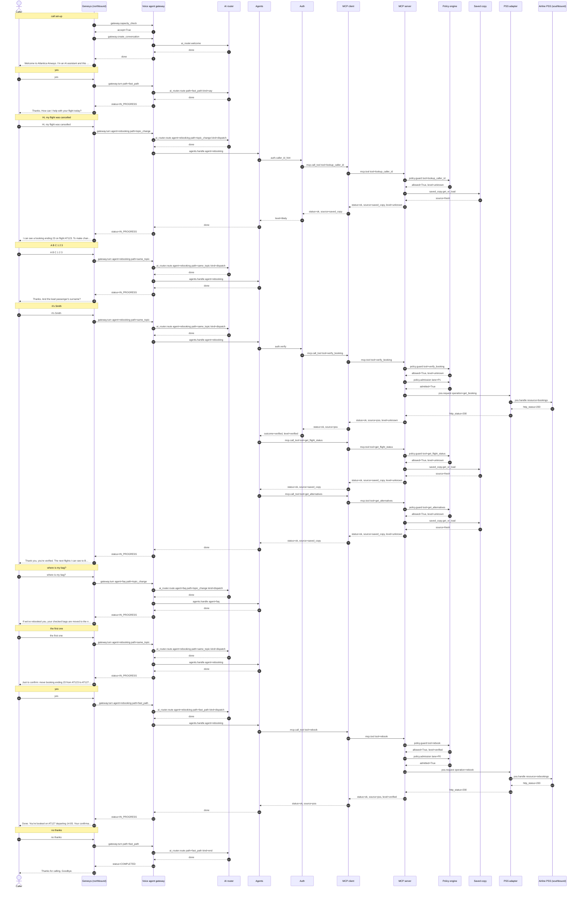

# Flow 01: Disrupted caller rebooks end to end

A passenger on the cancelled AT123 calls. Caller ID gives a masked hint (LIKELY), booking reference + surname make them VERIFIED, a baggage question is answered mid-task and the rebooking resumes, the new flight is committed in lane P0 and confirmed.

**Demonstrates:** verify on demand, identity levels, saved copy, side question + resume, P0 commit, signed identity token

**Result:** PASS · recorded 2026-10-11 17:47 · re-run with `python scripts/run_flow.py 01_happy_rebooking --trace`

## Setup

- reset PSS data, MCP lanes/saved copy/breaker, voice-agent sessions and lockouts
- disruption event for AT123: saved copy pre-warmed ({'flight': 'AT123', 'status': 'CANCELLED', 'bookings': 180, 'alternatives': 2, 'pss_requests': 3})

## Conversation

Genesys routed the call to **zingly**.

| # | Caller | Bot | Path → agent | Identity | ms |
|---|---|---|---|---|---|
| 0 | *(dials)* | Welcome to Atlantica Airways. I'm an AI assistant and this call may be recorded. Is that OK? | welcome (pre-rendered) | unknown | |
| 1 | yes | Thanks. How can I help with your flight today? | fast_path | unknown | 0.9 |
| 2 | Hi, my flight was cancelled | I can see a booking ending 23 on flight AT123. To make changes I need to verify you. What's your six-character booking reference? | topic_change → rebooking | likely | 51.7 |
| 3 | A B C 1 2 3 | Thanks. And the lead passenger's surname? | same_topic → rebooking | likely | 0.4 |
| 4 | it's Smith | Thank you, you're verified. The next flights I can see to Boston are 14:05 on AT127 and 19:40 on AT131. Which would you like: the first or the second? | same_topic → rebooking | verified | 214.6 |
| 5 | where is my bag? | If we've rebooked you, your checked bags are moved to the new flight automatically. Now, back to your rebooking: which would you like: the first or the second? | topic_change → faq | verified | 0.6 |
| 6 | the first one | Just to confirm: move booking ending 23 from AT123 to AT127, departing 14:05. Shall I go ahead? | same_topic → rebooking | verified | 0.8 |
| 7 | yes | Done. You're booked on AT127 departing 14:05. Your confirmation, RB00001, is on its way by text. Is there anything else I can help with? | fast_path → rebooking | verified | 162.5 |
| 8 | no thanks | Thanks for calling. Goodbye. | fast_path | verified | 0.4 |

### Sequence (built from the recorded spans)



### Traces

<details><summary>Call set-up</summary>

```text
[genesys] genesys: genesys.inbound_flow (31.4 ms) flow=Atlantica disruption line call_id=gen-e8b4fc02b6 caller=**********001 routed_to=zingly
  [voice-agent] gateway: gateway.capacity_check (4.3 ms) accept=True active=0 limit=500 breaker=closed
  [voice-agent] gateway: gateway.create_conversation (1.8 ms) call_id=gen-e8b4fc02b6 audio_id=atlantica:welcome:v1
    [voice-agent] ai-router: ai_router.welcome (1.6 ms)
```

</details>

<details><summary>Turn 1: “yes”</summary>

```text
[genesys] genesys: genesys.caller_turn (6.1 ms) call_id=gen-e8b4fc02b6 status=IN_PROGRESS
  [voice-agent] gateway: gateway.turn (1.0 ms) turn=1 status=IN_PROGRESS path=fast_path identity=unknown
    [voice-agent] channel: channel.inbound (0.2 ms) channel=text kind=speech chars=3
    [voice-agent] ai-router: ai_router.route (0.4 ms) kind=say path=fast_path
```

</details>

<details><summary>Turn 2: “Hi, my flight was cancelled”</summary>

```text
[genesys] genesys: genesys.caller_turn (55.7 ms) call_id=gen-e8b4fc02b6 status=IN_PROGRESS
  [voice-agent] gateway: gateway.turn (51.7 ms) turn=2 status=IN_PROGRESS path=topic_change agent=rebooking identity=likely
    [voice-agent] channel: channel.inbound (0.0 ms) channel=text kind=speech chars=27
    [voice-agent] ai-router: ai_router.route (0.2 ms) kind=dispatch path=topic_change agent=rebooking
    [voice-agent] agents: agents.handle (51.0 ms) agent=rebooking next_question=booking_ref identity=likely
      [voice-agent] auth: auth.caller_id_hint (50.5 ms) caller=**********001 level=likely
        [voice-agent] mcp-client: mcp.call_tool (50.1 ms) tool=lookup_caller_id identity=none status=ok source=saved_copy
          [mcp-server] mcp-server: mcp.tool (0.4 ms) tool=lookup_caller_id level=unknown status=ok source=saved_copy
            [mcp-server] policy: policy.guard (0.0 ms) tool=lookup_caller_id level=unknown allowed=True
            [mcp-server] saved-copy: saved_copy.get_or_load (0.0 ms) key=phone source=fresh
```

</details>

<details><summary>Turn 3: “A B C 1 2 3”</summary>

```text
[genesys] genesys: genesys.caller_turn (3.9 ms) call_id=gen-e8b4fc02b6 status=IN_PROGRESS
  [voice-agent] gateway: gateway.turn (0.4 ms) turn=3 status=IN_PROGRESS path=same_topic agent=rebooking identity=likely
    [voice-agent] channel: channel.inbound (0.0 ms) channel=text kind=speech chars=11
    [voice-agent] ai-router: ai_router.route (0.1 ms) active=rebooking pending=booking_ref kind=dispatch path=same_topic agent=rebooking
    [voice-agent] agents: agents.handle (0.0 ms) agent=rebooking pending=booking_ref next_question=surname
```

</details>

<details><summary>Turn 4: “it's Smith”</summary>

```text
[genesys] genesys: genesys.caller_turn (218.3 ms) call_id=gen-e8b4fc02b6 status=IN_PROGRESS
  [voice-agent] gateway: gateway.turn (214.6 ms) turn=4 status=IN_PROGRESS path=same_topic agent=rebooking identity=verified
    [voice-agent] channel: channel.inbound (0.0 ms) channel=text kind=speech chars=10
    [voice-agent] ai-router: ai_router.route (0.1 ms) active=rebooking pending=surname kind=dispatch path=same_topic agent=rebooking
    [voice-agent] agents: agents.handle (213.8 ms) agent=rebooking pending=surname next_question=choose_option identity=verified
      [voice-agent] auth: auth.verify (131.5 ms) booking=****23 outcome=verified level=verified
        [voice-agent] mcp-client: mcp.call_tool (131.1 ms) tool=verify_booking identity=none status=ok source=pss
          [mcp-server] mcp-server: mcp.tool (88.8 ms) tool=verify_booking level=unknown status=ok source=pss
            [mcp-server] policy: policy.guard (0.0 ms) tool=verify_booking level=unknown allowed=True
            [mcp-server] policy: policy.admission (0.0 ms) lane=P1 wait_budget_s=1.5 admitted=True waited_ms=0.0
            [mcp-server] pss-adapter: pss.request (88.2 ms) method=GET operation=get_booking http_status=200
              [airline-pss] airline-pss: pss.handle (83.7 ms) airline=atlantica method=GET resource=bookings http_status=200 limit_rps=5
      [voice-agent] mcp-client: mcp.call_tool (40.6 ms) tool=get_flight_status identity=none status=ok source=saved_copy
        [mcp-server] mcp-server: mcp.tool (0.4 ms) tool=get_flight_status level=unknown status=ok source=saved_copy
          [mcp-server] policy: policy.guard (0.0 ms) tool=get_flight_status level=unknown allowed=True
          [mcp-server] saved-copy: saved_copy.get_or_load (0.0 ms) key=flight source=fresh
      [voice-agent] mcp-client: mcp.call_tool (40.8 ms) tool=get_alternatives identity=none status=ok source=saved_copy
        [mcp-server] mcp-server: mcp.tool (0.4 ms) tool=get_alternatives level=unknown status=ok source=saved_copy
          [mcp-server] policy: policy.guard (0.0 ms) tool=get_alternatives level=unknown allowed=True
          [mcp-server] saved-copy: saved_copy.get_or_load (0.0 ms) key=alts source=fresh
```

</details>

<details><summary>Turn 5: “where is my bag?”</summary>

```text
[genesys] genesys: genesys.caller_turn (4.3 ms) call_id=gen-e8b4fc02b6 status=IN_PROGRESS
  [voice-agent] gateway: gateway.turn (0.7 ms) turn=5 status=IN_PROGRESS path=topic_change agent=faq identity=verified
    [voice-agent] channel: channel.inbound (0.0 ms) channel=text kind=speech chars=16
    [voice-agent] ai-router: ai_router.route (0.2 ms) active=rebooking pending=choose_option kind=dispatch path=topic_change agent=faq
    [voice-agent] agents: agents.handle (0.1 ms) agent=faq next_question=choose_option resumed=rebooking
```

</details>

<details><summary>Turn 6: “the first one”</summary>

```text
[genesys] genesys: genesys.caller_turn (4.4 ms) call_id=gen-e8b4fc02b6 status=IN_PROGRESS
  [voice-agent] gateway: gateway.turn (0.8 ms) turn=6 status=IN_PROGRESS path=same_topic agent=rebooking identity=verified
    [voice-agent] channel: channel.inbound (0.0 ms) channel=text kind=speech chars=13
    [voice-agent] ai-router: ai_router.route (0.1 ms) active=rebooking pending=choose_option kind=dispatch path=same_topic agent=rebooking
    [voice-agent] agents: agents.handle (0.2 ms) agent=rebooking pending=choose_option next_question=confirm_rebook
```

</details>

<details><summary>Turn 7: “yes”</summary>

```text
[genesys] genesys: genesys.caller_turn (166.7 ms) call_id=gen-e8b4fc02b6 status=IN_PROGRESS
  [voice-agent] gateway: gateway.turn (162.5 ms) turn=7 status=IN_PROGRESS path=fast_path agent=rebooking identity=verified
    [voice-agent] channel: channel.inbound (0.0 ms) channel=text kind=speech chars=3
    [voice-agent] ai-router: ai_router.route (0.1 ms) active=rebooking pending=confirm_rebook kind=dispatch path=fast_path agent=rebooking yes_no=yes
    [voice-agent] agents: agents.handle (162.0 ms) agent=rebooking pending=confirm_rebook done=True
      [voice-agent] mcp-client: mcp.call_tool (161.8 ms) tool=rebook identity=token status=ok source=pss
        [mcp-server] mcp-server: mcp.tool (123.1 ms) tool=rebook level=verified status=ok source=pss
          [mcp-server] policy: policy.guard (0.0 ms) tool=rebook level=verified allowed=True
          [mcp-server] policy: policy.admission (0.0 ms) lane=P0 wait_budget_s=3.0 admitted=True waited_ms=0.0
          [mcp-server] pss-adapter: pss.request (122.6 ms) method=POST operation=rebook http_status=200
            [airline-pss] airline-pss: pss.handle (119.0 ms) airline=atlantica method=POST resource=rebookings http_status=200 limit_rps=5
```

</details>

<details><summary>Turn 8: “no thanks”</summary>

```text
[genesys] genesys: genesys.caller_turn (4.1 ms) call_id=gen-e8b4fc02b6 status=COMPLETED
  [voice-agent] gateway: gateway.turn (0.4 ms) turn=8 status=COMPLETED path=fast_path identity=verified
    [voice-agent] channel: channel.inbound (0.0 ms) channel=text kind=speech chars=9
    [voice-agent] ai-router: ai_router.route (0.1 ms) kind=end path=fast_path
```

</details>

## Background work during this flow

<details><summary>gateway.disruption_event (5129 ms)</summary>

```text
[voice-agent] gateway: gateway.disruption_event (5128.9 ms) flight=AT123
  [mcp-server] mcp-server: mcp.prewarm (5111.2 ms) flight=AT123
    [mcp-server] policy: policy.admission (0.1 ms) lane=P3 wait_budget_s=10 admitted=True waited_ms=0.0
    [mcp-server] pss-adapter: pss.request (68.4 ms) method=GET operation=get_flight http_status=200
      [airline-pss] airline-pss: pss.handle (62.5 ms) airline=atlantica method=GET resource=flights http_status=200 limit_rps=5
    [mcp-server] policy: policy.admission (2439.9 ms) lane=P3 wait_budget_s=10 admitted=True waited_ms=2439.9
    [mcp-server] pss-adapter: pss.request (90.8 ms) method=GET operation=get_passenger_list http_status=200
      [airline-pss] airline-pss: pss.handle (84.9 ms) airline=atlantica method=GET resource=flights http_status=200 limit_rps=5
    [mcp-server] policy: policy.admission (2408.4 ms) lane=P3 wait_budget_s=10 admitted=True waited_ms=2408.3
    [mcp-server] pss-adapter: pss.request (100.5 ms) method=GET operation=get_alternatives http_status=200
      [airline-pss] airline-pss: pss.handle (95.6 ms) airline=atlantica method=GET resource=alternatives http_status=200 limit_rps=5
```

</details>

## Components involved

| Process | Component | Operations seen in this run |
|---|---|---|
| `airline-pss` | airline-pss | `pss.handle` |
| `genesys` | genesys | `genesys.caller_turn`, `genesys.inbound_flow` |
| `mcp-server` | mcp-server | `mcp.prewarm`, `mcp.tool` |
| `mcp-server` | policy | `policy.admission`, `policy.guard` |
| `mcp-server` | pss-adapter | `pss.request` |
| `mcp-server` | saved-copy | `saved_copy.get_or_load` |
| `voice-agent` | agents | `agents.handle` |
| `voice-agent` | ai-router | `ai_router.route`, `ai_router.welcome` |
| `voice-agent` | auth | `auth.caller_id_hint`, `auth.verify` |
| `voice-agent` | channel | `channel.inbound` |
| `voice-agent` | gateway | `gateway.capacity_check`, `gateway.create_conversation`, `gateway.disruption_event`, `gateway.turn` |
| `voice-agent` | mcp-client | `mcp.call_tool` |

## Checks

- ✅ call 1: routed to zingly (got zingly)
- ✅ call 1 turn 1: path = fast_path (got fast_path)
- ✅ call 1 turn 1: reply contains 'How can I help'
- ✅ call 1 turn 2: agent = rebooking (got rebooking)
- ✅ call 1 turn 2: identity = likely (got likely)
- ✅ call 1 turn 2: reply contains 'ending 23'
- ✅ call 1 turn 3: reply contains 'surname'
- ✅ call 1 turn 4: identity = verified (got verified)
- ✅ call 1 turn 4: reply contains ['14:05', '19:40']
- ✅ call 1 turn 5: agent = faq (got faq)
- ✅ call 1 turn 5: reply contains 'back to your rebooking'
- ✅ call 1 turn 6: reply contains 'Shall I go ahead'
- ✅ call 1 turn 7: reply contains 'booked on AT127'
- ✅ call 1 turn 8: call status COMPLETED (got COMPLETED)
- ✅ check: PSS booking ABC123 on AT127 (got AT127)
