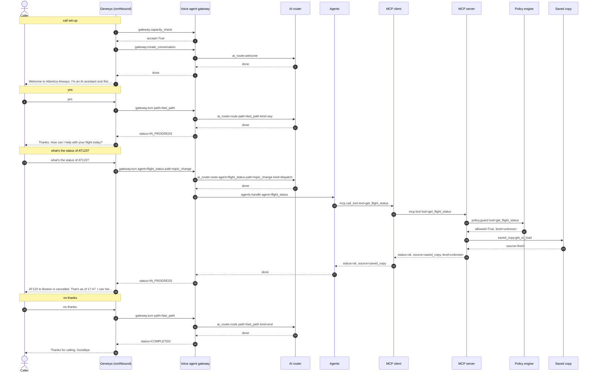

# Flow 02: Flight status for an unknown caller, from the saved copy

Flight status is public, so no identity check is asked. The answer comes from the saved copy pre-warmed by the disruption event: zero reservation-system requests, labelled "as of".

**Demonstrates:** verify on demand (not needed), saved copy, P3 lane not used, as-of wording

**Result:** PASS · recorded 2026-10-11 17:47 · re-run with `python scripts/run_flow.py 02_flight_status_public --trace`

## Setup

- reset PSS data, MCP lanes/saved copy/breaker, voice-agent sessions and lockouts
- disruption event for AT123: saved copy pre-warmed ({'flight': 'AT123', 'status': 'CANCELLED', 'bookings': 180, 'alternatives': 2, 'pss_requests': 3})

## Conversation

Genesys routed the call to **zingly**.

| # | Caller | Bot | Path → agent | Identity | ms |
|---|---|---|---|---|---|
| 0 | *(dials)* | Welcome to Atlantica Airways. I'm an AI assistant and this call may be recorded. Is that OK? | welcome (pre-rendered) | unknown | |
| 1 | yes | Thanks. How can I help with your flight today? | fast_path | unknown | 0.3 |
| 2 | what's the status of AT123? | AT123 to Boston is cancelled. That's as of 17:47. I can help you rebook if you like. Is there anything else I can help with? | topic_change → flight_status | unknown | 29.4 |
| 3 | no thanks | Thanks for calling. Goodbye. | fast_path | unknown | 0.4 |

### Sequence (built from the recorded spans)



### Traces

<details><summary>Call set-up</summary>

```text
[genesys] genesys: genesys.inbound_flow (10.5 ms) flow=Atlantica disruption line call_id=gen-793c2381a5 caller=*********001 routed_to=zingly
  [voice-agent] gateway: gateway.capacity_check (2.7 ms) accept=True active=0 limit=500 breaker=closed
  [voice-agent] gateway: gateway.create_conversation (0.4 ms) call_id=gen-793c2381a5 audio_id=atlantica:welcome:v1
    [voice-agent] ai-router: ai_router.welcome (0.2 ms)
```

</details>

<details><summary>Turn 1: “yes”</summary>

```text
[genesys] genesys: genesys.caller_turn (5.5 ms) call_id=gen-793c2381a5 status=IN_PROGRESS
  [voice-agent] gateway: gateway.turn (0.3 ms) turn=1 status=IN_PROGRESS path=fast_path identity=unknown
    [voice-agent] channel: channel.inbound (0.0 ms) channel=text kind=speech chars=3
    [voice-agent] ai-router: ai_router.route (0.1 ms) kind=say path=fast_path
```

</details>

<details><summary>Turn 2: “what's the status of AT123?”</summary>

```text
[genesys] genesys: genesys.caller_turn (32.8 ms) call_id=gen-793c2381a5 status=IN_PROGRESS
  [voice-agent] gateway: gateway.turn (29.4 ms) turn=2 status=IN_PROGRESS path=topic_change agent=flight_status identity=unknown
    [voice-agent] channel: channel.inbound (0.0 ms) channel=text kind=speech chars=27
    [voice-agent] ai-router: ai_router.route (0.1 ms) kind=dispatch path=topic_change agent=flight_status
    [voice-agent] agents: agents.handle (29.0 ms) agent=flight_status done=True
      [voice-agent] mcp-client: mcp.call_tool (28.6 ms) tool=get_flight_status identity=none status=ok source=saved_copy
        [mcp-server] mcp-server: mcp.tool (0.3 ms) tool=get_flight_status level=unknown status=ok source=saved_copy
          [mcp-server] policy: policy.guard (0.0 ms) tool=get_flight_status level=unknown allowed=True
          [mcp-server] saved-copy: saved_copy.get_or_load (0.0 ms) key=flight source=fresh
```

</details>

<details><summary>Turn 3: “no thanks”</summary>

```text
[genesys] genesys: genesys.caller_turn (3.6 ms) call_id=gen-793c2381a5 status=COMPLETED
  [voice-agent] gateway: gateway.turn (0.4 ms) turn=3 status=COMPLETED path=fast_path identity=unknown
    [voice-agent] channel: channel.inbound (0.0 ms) channel=text kind=speech chars=9
    [voice-agent] ai-router: ai_router.route (0.1 ms) kind=end path=fast_path
```

</details>

## Background work during this flow

<details><summary>gateway.disruption_event (5111 ms)</summary>

```text
[voice-agent] gateway: gateway.disruption_event (5110.9 ms) flight=AT123
  [mcp-server] mcp-server: mcp.prewarm (5106.9 ms) flight=AT123
    [mcp-server] policy: policy.admission (0.0 ms) lane=P3 wait_budget_s=10 admitted=True waited_ms=0.0
    [mcp-server] pss-adapter: pss.request (122.3 ms) method=GET operation=get_flight http_status=200
      [airline-pss] airline-pss: pss.handle (118.4 ms) airline=atlantica method=GET resource=flights http_status=200 limit_rps=5
    [mcp-server] policy: policy.admission (2387.2 ms) lane=P3 wait_budget_s=10 admitted=True waited_ms=2387.1
    [mcp-server] pss-adapter: pss.request (108.5 ms) method=GET operation=get_passenger_list http_status=200
      [airline-pss] airline-pss: pss.handle (104.8 ms) airline=atlantica method=GET resource=flights http_status=200 limit_rps=5
    [mcp-server] policy: policy.admission (2391.5 ms) lane=P3 wait_budget_s=10 admitted=True waited_ms=2391.5
    [mcp-server] pss-adapter: pss.request (95.8 ms) method=GET operation=get_alternatives http_status=200
      [airline-pss] airline-pss: pss.handle (92.3 ms) airline=atlantica method=GET resource=alternatives http_status=200 limit_rps=5
```

</details>

## Components involved

| Process | Component | Operations seen in this run |
|---|---|---|
| `airline-pss` | airline-pss | `pss.handle` |
| `genesys` | genesys | `genesys.caller_turn`, `genesys.inbound_flow` |
| `mcp-server` | mcp-server | `mcp.prewarm`, `mcp.tool` |
| `mcp-server` | policy | `policy.admission`, `policy.guard` |
| `mcp-server` | pss-adapter | `pss.request` |
| `mcp-server` | saved-copy | `saved_copy.get_or_load` |
| `voice-agent` | agents | `agents.handle` |
| `voice-agent` | ai-router | `ai_router.route`, `ai_router.welcome` |
| `voice-agent` | channel | `channel.inbound` |
| `voice-agent` | gateway | `gateway.capacity_check`, `gateway.create_conversation`, `gateway.disruption_event`, `gateway.turn` |
| `voice-agent` | mcp-client | `mcp.call_tool` |

## Checks

- ✅ call 1: routed to zingly (got zingly)
- ✅ call 1 turn 2: agent = flight_status (got flight_status)
- ✅ call 1 turn 2: identity = unknown (got unknown)
- ✅ call 1 turn 2: reply contains ['cancelled', 'as of']
- ✅ call 1 turn 3: call status COMPLETED (got COMPLETED)
- ✅ check: PSS requests during the call ≤ 0 (got 0)
