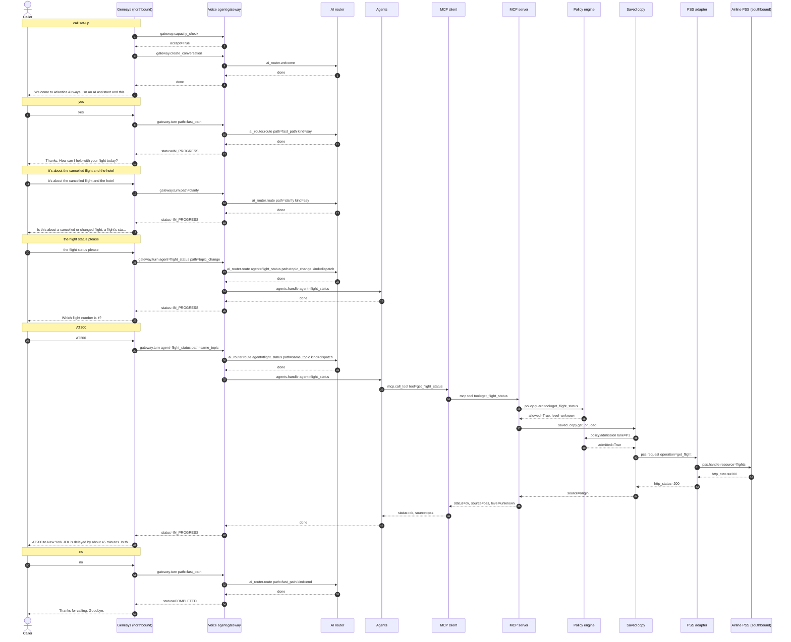

# Flow 03: Ambiguous request, one clarifying question, then routed

"The cancelled flight and the hotel" matches two domains equally, so the router asks one short question instead of guessing; the answer routes to the right agent.

**Demonstrates:** disambiguation, clarify path, topic routing

**Result:** PASS · recorded 2026-10-11 17:47 · re-run with `python scripts/run_flow.py 03_clarify_then_route --trace`

## Setup

- reset PSS data, MCP lanes/saved copy/breaker, voice-agent sessions and lockouts

## Conversation

Genesys routed the call to **zingly**.

| # | Caller | Bot | Path → agent | Identity | ms |
|---|---|---|---|---|---|
| 0 | *(dials)* | Welcome to Atlantica Airways. I'm an AI assistant and this call may be recorded. Is that OK? | welcome (pre-rendered) | unknown | |
| 1 | yes | Thanks. How can I help with your flight today? | fast_path | unknown | 0.3 |
| 2 | it's about the cancelled flight and the hotel | Is this about a cancelled or changed flight, a flight's status, or something else, like baggage? | clarify | unknown | 0.3 |
| 3 | the flight status please | Which flight number is it? | topic_change → flight_status | unknown | 0.5 |
| 4 | AT200 | AT200 to New York JFK is delayed by about 45 minutes. Is there anything else I can help with? | same_topic → flight_status | unknown | 100.0 |
| 5 | no | Thanks for calling. Goodbye. | fast_path | unknown | 0.4 |

### Sequence (built from the recorded spans)



### Traces

<details><summary>Call set-up</summary>

```text
[genesys] genesys: genesys.inbound_flow (8.9 ms) flow=Atlantica disruption line call_id=gen-a309690eb5 caller=*********002 routed_to=zingly
  [voice-agent] gateway: gateway.capacity_check (2.6 ms) accept=True active=0 limit=500 breaker=closed
  [voice-agent] gateway: gateway.create_conversation (0.4 ms) call_id=gen-a309690eb5 audio_id=atlantica:welcome:v1
    [voice-agent] ai-router: ai_router.welcome (0.2 ms)
```

</details>

<details><summary>Turn 1: “yes”</summary>

```text
[genesys] genesys: genesys.caller_turn (3.3 ms) call_id=gen-a309690eb5 status=IN_PROGRESS
  [voice-agent] gateway: gateway.turn (0.3 ms) turn=1 status=IN_PROGRESS path=fast_path identity=unknown
    [voice-agent] channel: channel.inbound (0.0 ms) channel=text kind=speech chars=3
    [voice-agent] ai-router: ai_router.route (0.0 ms) kind=say path=fast_path
```

</details>

<details><summary>Turn 2: “it's about the cancelled flight and the hotel”</summary>

```text
[genesys] genesys: genesys.caller_turn (3.3 ms) call_id=gen-a309690eb5 status=IN_PROGRESS
  [voice-agent] gateway: gateway.turn (0.3 ms) turn=2 status=IN_PROGRESS path=clarify identity=unknown
    [voice-agent] channel: channel.inbound (0.0 ms) channel=text kind=speech chars=45
    [voice-agent] ai-router: ai_router.route (0.1 ms) kind=say path=clarify
```

</details>

<details><summary>Turn 3: “the flight status please”</summary>

```text
[genesys] genesys: genesys.caller_turn (3.4 ms) call_id=gen-a309690eb5 status=IN_PROGRESS
  [voice-agent] gateway: gateway.turn (0.5 ms) turn=3 status=IN_PROGRESS path=topic_change agent=flight_status identity=unknown
    [voice-agent] channel: channel.inbound (0.0 ms) channel=text kind=speech chars=24
    [voice-agent] ai-router: ai_router.route (0.1 ms) kind=dispatch path=topic_change agent=flight_status
    [voice-agent] agents: agents.handle (0.0 ms) agent=flight_status next_question=flight_number
```

</details>

<details><summary>Turn 4: “AT200”</summary>

```text
[genesys] genesys: genesys.caller_turn (103.9 ms) call_id=gen-a309690eb5 status=IN_PROGRESS
  [voice-agent] gateway: gateway.turn (100.0 ms) turn=4 status=IN_PROGRESS path=same_topic agent=flight_status identity=unknown
    [voice-agent] channel: channel.inbound (0.0 ms) channel=text kind=speech chars=5
    [voice-agent] ai-router: ai_router.route (0.1 ms) active=flight_status pending=flight_number kind=dispatch path=same_topic agent=flight_status
    [voice-agent] agents: agents.handle (99.6 ms) agent=flight_status pending=flight_number done=True
      [voice-agent] mcp-client: mcp.call_tool (99.4 ms) tool=get_flight_status identity=none status=ok source=pss
        [mcp-server] mcp-server: mcp.tool (61.9 ms) tool=get_flight_status level=unknown status=ok source=pss
          [mcp-server] policy: policy.guard (0.0 ms) tool=get_flight_status level=unknown allowed=True
          [mcp-server] saved-copy: saved_copy.get_or_load (61.6 ms) key=flight source=origin
            [mcp-server] policy: policy.admission (0.0 ms) lane=P3 wait_budget_s=0.0 admitted=True waited_ms=0.0
            [mcp-server] pss-adapter: pss.request (61.2 ms) method=GET operation=get_flight http_status=200
              [airline-pss] airline-pss: pss.handle (55.8 ms) airline=atlantica method=GET resource=flights http_status=200 limit_rps=5
```

</details>

<details><summary>Turn 5: “no”</summary>

```text
[genesys] genesys: genesys.caller_turn (3.7 ms) call_id=gen-a309690eb5 status=COMPLETED
  [voice-agent] gateway: gateway.turn (0.4 ms) turn=5 status=COMPLETED path=fast_path identity=unknown
    [voice-agent] channel: channel.inbound (0.0 ms) channel=text kind=speech chars=2
    [voice-agent] ai-router: ai_router.route (0.1 ms) kind=end path=fast_path
```

</details>

## Components involved

| Process | Component | Operations seen in this run |
|---|---|---|
| `airline-pss` | airline-pss | `pss.handle` |
| `genesys` | genesys | `genesys.caller_turn`, `genesys.inbound_flow` |
| `mcp-server` | mcp-server | `mcp.tool` |
| `mcp-server` | policy | `policy.admission`, `policy.guard` |
| `mcp-server` | pss-adapter | `pss.request` |
| `mcp-server` | saved-copy | `saved_copy.get_or_load` |
| `voice-agent` | agents | `agents.handle` |
| `voice-agent` | ai-router | `ai_router.route`, `ai_router.welcome` |
| `voice-agent` | channel | `channel.inbound` |
| `voice-agent` | gateway | `gateway.capacity_check`, `gateway.create_conversation`, `gateway.turn` |
| `voice-agent` | mcp-client | `mcp.call_tool` |

## Checks

- ✅ call 1: routed to zingly (got zingly)
- ✅ call 1 turn 2: path = clarify (got clarify)
- ✅ call 1 turn 2: reply contains 'Is this about'
- ✅ call 1 turn 3: agent = flight_status (got flight_status)
- ✅ call 1 turn 3: reply contains 'Which flight number'
- ✅ call 1 turn 4: reply contains 'delayed by about 45 minutes'
- ✅ call 1 turn 5: call status COMPLETED (got COMPLETED)
