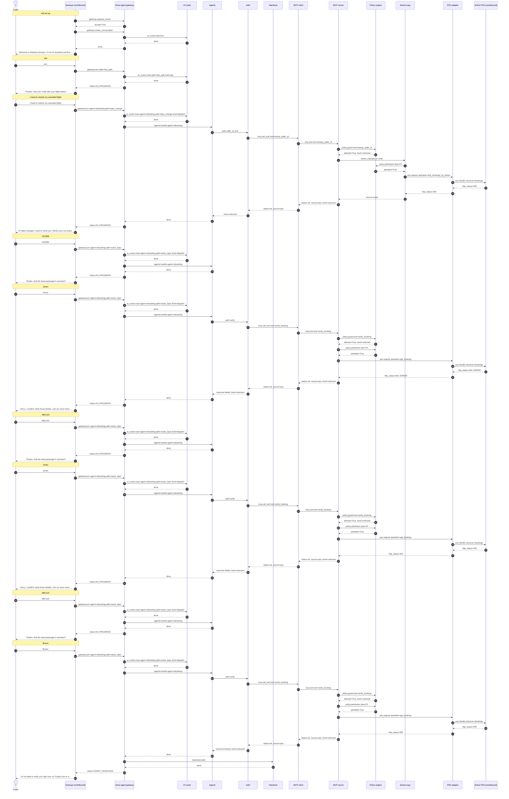

# Flow 04: Three failed verifications lock self-service

Wrong details three times locks self-service for the caller's number. Failures never say whether the reference exists. The caller is handed over as not verified.

**Demonstrates:** fraud controls, lockout, no existence leak, handover with identity level

**Result:** PASS · recorded 2026-10-11 17:47 · re-run with `python scripts/run_flow.py 04_verification_lockout --trace`

## Setup

- reset PSS data, MCP lanes/saved copy/breaker, voice-agent sessions and lockouts

## Conversation

Genesys routed the call to **zingly**.

| # | Caller | Bot | Path → agent | Identity | ms |
|---|---|---|---|---|---|
| 0 | *(dials)* | Welcome to Atlantica Airways. I'm an AI assistant and this call may be recorded. Is that OK? | welcome (pre-rendered) | unknown | |
| 1 | yes | Thanks. How can I help with your flight today? | fast_path | unknown | 0.4 |
| 2 | I need to rebook my cancelled flight | To make changes I need to verify you. What's your six-character booking reference? | topic_change → rebooking | unknown | 89.9 |
| 3 | ZZZ999 | Thanks. And the lead passenger's surname? | same_topic → rebooking | unknown | 0.6 |
| 4 | Jones | Sorry, I couldn't verify those details. Let's try once more: what's the booking reference? | same_topic → rebooking | unknown | 239.4 |
| 5 | ABC123 | Thanks. And the lead passenger's surname? | same_topic → rebooking | unknown | 0.7 |
| 6 | Jones | Sorry, I couldn't verify those details. Let's try once more: what's the booking reference? | same_topic → rebooking | unknown | 233.5 |
| 7 | ABC123 | Thanks. And the lead passenger's surname? | same_topic → rebooking | unknown | 0.4 |
| 8 | Brown | I'm not able to verify you right now, so I'll pass you to a colleague who can help. | same_topic → rebooking | unknown | 273.9 |

### Handover: Genesys screen-pop

Queue **Disruption_Rebooking**, callback_offered (estimated wait 300 s).

```json
{
  "conversation_status": "AGENT_HANDOVER",
  "tenant_id": "atlantica",
  "conversation_id": "conv-b70c4ceb3241",
  "call_id": "gen-a3a3310f0c",
  "routing": {
    "queue": "Disruption_Rebooking",
    "category": "rebooking",
    "subcategory": "verification_failed",
    "priority": 10,
    "callback_eligible": true
  },
  "summary": "Caller unknown. Reason for handover: caller could not be verified. Tried: verify_identity -> failed; verify_identity -> failed; verify_identity -> locked.",
  "caller": {
    "number_masked": "+15******003",
    "identity_level": "unknown",
    "verified_by": null
  },
  "booking": null,
  "disruption": null,
  "attempted_actions": [
    {
      "action": "verify_identity",
      "result": "failed",
      "detail": "",
      "args": {},
      "at": 1791740876.3151512
    },
    {
      "action": "verify_identity",
      "result": "failed",
      "detail": "",
      "args": {},
      "at": 1791740876.3151538
    },
    {
      "action": "verify_identity",
      "result": "locked",
      "detail": "",
      "args": {},
      "at": 1791740876.3151548
    }
  ],
  "context_ref": "0cabf72b-5aab-4a1d-8a59-3401317e5035",
  "genesys_participant_data": {
    "zingly.conversationStatus": "AGENT_HANDOVER",
    "zingly.category": "rebooking",
    "zingly.subcategory": "verification_failed",
    "zingly.summary": "Caller unknown. Reason for handover: caller could not be verified. Tried: verify_identity -> failed; verify_identity -> failed; verify_identity -> locked.",
    "zingly.identityLevel": "unknown",
    "zingly.bookingRefMasked": "",
    "zingly.attemptedActions": "3",
    "zingly.contextRef": "0cabf72b-5aab-4a1d-8a59-3401317e5035"
  },
  "data_notes": []
}
```

### Sequence (built from the recorded spans)



### Traces

<details><summary>Call set-up</summary>

```text
[genesys] genesys: genesys.inbound_flow (10.7 ms) flow=Atlantica disruption line call_id=gen-a3a3310f0c caller=*********003 routed_to=zingly
  [voice-agent] gateway: gateway.capacity_check (3.3 ms) accept=True active=0 limit=500 breaker=closed
  [voice-agent] gateway: gateway.create_conversation (0.6 ms) call_id=gen-a3a3310f0c audio_id=atlantica:welcome:v1
    [voice-agent] ai-router: ai_router.welcome (0.3 ms)
```

</details>

<details><summary>Turn 1: “yes”</summary>

```text
[genesys] genesys: genesys.caller_turn (4.7 ms) call_id=gen-a3a3310f0c status=IN_PROGRESS
  [voice-agent] gateway: gateway.turn (0.5 ms) turn=1 status=IN_PROGRESS path=fast_path identity=unknown
    [voice-agent] channel: channel.inbound (0.0 ms) channel=text kind=speech chars=3
    [voice-agent] ai-router: ai_router.route (0.1 ms) kind=say path=fast_path
```

</details>

<details><summary>Turn 2: “I need to rebook my cancelled flight”</summary>

```text
[genesys] genesys: genesys.caller_turn (94.0 ms) call_id=gen-a3a3310f0c status=IN_PROGRESS
  [voice-agent] gateway: gateway.turn (89.9 ms) turn=2 status=IN_PROGRESS path=topic_change agent=rebooking identity=unknown
    [voice-agent] channel: channel.inbound (0.0 ms) channel=text kind=speech chars=36
    [voice-agent] ai-router: ai_router.route (0.2 ms) kind=dispatch path=topic_change agent=rebooking
    [voice-agent] agents: agents.handle (89.2 ms) agent=rebooking next_question=booking_ref
      [voice-agent] auth: auth.caller_id_hint (89.1 ms) caller=*********003 level=unknown
        [voice-agent] mcp-client: mcp.call_tool (88.8 ms) tool=lookup_caller_id identity=none status=ok source=pss
          [mcp-server] mcp-server: mcp.tool (53.0 ms) tool=lookup_caller_id level=unknown status=ok source=pss
            [mcp-server] policy: policy.guard (0.0 ms) tool=lookup_caller_id level=unknown allowed=True
            [mcp-server] saved-copy: saved_copy.get_or_load (52.6 ms) key=phone source=origin
              [mcp-server] policy: policy.admission (0.0 ms) lane=P1 wait_budget_s=1.5 admitted=True waited_ms=0.0
              [mcp-server] pss-adapter: pss.request (52.2 ms) method=GET operation=find_bookings_by_phone http_status=200
                [airline-pss] airline-pss: pss.handle (48.4 ms) airline=atlantica method=GET resource=bookings http_status=200 limit_rps=5
```

</details>

<details><summary>Turn 3: “ZZZ999”</summary>

```text
[genesys] genesys: genesys.caller_turn (3.9 ms) call_id=gen-a3a3310f0c status=IN_PROGRESS
  [voice-agent] gateway: gateway.turn (0.6 ms) turn=3 status=IN_PROGRESS path=same_topic agent=rebooking identity=unknown
    [voice-agent] channel: channel.inbound (0.0 ms) channel=text kind=speech chars=6
    [voice-agent] ai-router: ai_router.route (0.1 ms) active=rebooking pending=booking_ref kind=dispatch path=same_topic agent=rebooking
    [voice-agent] agents: agents.handle (0.0 ms) agent=rebooking pending=booking_ref next_question=surname
```

</details>

<details><summary>Turn 4: “Jones”</summary>

```text
[genesys] genesys: genesys.caller_turn (246.1 ms) call_id=gen-a3a3310f0c status=IN_PROGRESS
  [voice-agent] gateway: gateway.turn (239.5 ms) turn=4 status=IN_PROGRESS path=same_topic agent=rebooking identity=unknown
    [voice-agent] channel: channel.inbound (0.0 ms) channel=text kind=speech chars=5
    [voice-agent] ai-router: ai_router.route (0.1 ms) active=rebooking pending=surname kind=dispatch path=same_topic agent=rebooking
    [voice-agent] agents: agents.handle (239.0 ms) agent=rebooking pending=surname next_question=booking_ref
      [voice-agent] auth: auth.verify (238.9 ms) booking=****99 outcome=failed level=unknown attempts_left=2
        [voice-agent] mcp-client: mcp.call_tool (238.6 ms) tool=verify_booking identity=none status=ok source=pss
          [mcp-server] mcp-server: mcp.tool (206.8 ms) tool=verify_booking level=unknown status=ok source=pss
            [mcp-server] policy: policy.guard (0.0 ms) tool=verify_booking level=unknown allowed=True
            [mcp-server] policy: policy.admission (151.7 ms) lane=P1 wait_budget_s=1.5 admitted=True waited_ms=151.7
            ✗ [mcp-server] pss-adapter: pss.request (54.6 ms) method=GET operation=get_booking http_status=404 error=NotFound
              ✗ [airline-pss] airline-pss: pss.handle (51.1 ms) airline=atlantica method=GET resource=bookings http_status=404 limit_rps=5
```

</details>

<details><summary>Turn 5: “ABC123”</summary>

```text
[genesys] genesys: genesys.caller_turn (4.5 ms) call_id=gen-a3a3310f0c status=IN_PROGRESS
  [voice-agent] gateway: gateway.turn (0.7 ms) turn=5 status=IN_PROGRESS path=same_topic agent=rebooking identity=unknown
    [voice-agent] channel: channel.inbound (0.1 ms) channel=text kind=speech chars=6
    [voice-agent] ai-router: ai_router.route (0.1 ms) active=rebooking pending=booking_ref kind=dispatch path=same_topic agent=rebooking
    [voice-agent] agents: agents.handle (0.0 ms) agent=rebooking pending=booking_ref next_question=surname
```

</details>

<details><summary>Turn 6: “Jones”</summary>

```text
[genesys] genesys: genesys.caller_turn (237.0 ms) call_id=gen-a3a3310f0c status=IN_PROGRESS
  [voice-agent] gateway: gateway.turn (233.5 ms) turn=6 status=IN_PROGRESS path=same_topic agent=rebooking identity=unknown
    [voice-agent] channel: channel.inbound (0.0 ms) channel=text kind=speech chars=5
    [voice-agent] ai-router: ai_router.route (0.1 ms) active=rebooking pending=surname kind=dispatch path=same_topic agent=rebooking
    [voice-agent] agents: agents.handle (233.0 ms) agent=rebooking pending=surname next_question=booking_ref
      [voice-agent] auth: auth.verify (232.8 ms) booking=****23 outcome=failed level=unknown attempts_left=1
        [voice-agent] mcp-client: mcp.call_tool (232.6 ms) tool=verify_booking identity=none status=ok source=pss
          [mcp-server] mcp-server: mcp.tool (201.3 ms) tool=verify_booking level=unknown status=ok source=pss
            [mcp-server] policy: policy.guard (0.0 ms) tool=verify_booking level=unknown allowed=True
            [mcp-server] policy: policy.admission (151.8 ms) lane=P1 wait_budget_s=1.5 admitted=True waited_ms=151.7
            [mcp-server] pss-adapter: pss.request (49.0 ms) method=GET operation=get_booking http_status=200
              [airline-pss] airline-pss: pss.handle (44.5 ms) airline=atlantica method=GET resource=bookings http_status=200 limit_rps=5
```

</details>

<details><summary>Turn 7: “ABC123”</summary>

```text
[genesys] genesys: genesys.caller_turn (3.7 ms) call_id=gen-a3a3310f0c status=IN_PROGRESS
  [voice-agent] gateway: gateway.turn (0.4 ms) turn=7 status=IN_PROGRESS path=same_topic agent=rebooking identity=unknown
    [voice-agent] channel: channel.inbound (0.0 ms) channel=text kind=speech chars=6
    [voice-agent] ai-router: ai_router.route (0.1 ms) active=rebooking pending=booking_ref kind=dispatch path=same_topic agent=rebooking
    [voice-agent] agents: agents.handle (0.0 ms) agent=rebooking pending=booking_ref next_question=surname
```

</details>

<details><summary>Turn 8: “Brown”</summary>

```text
[genesys] genesys: genesys.caller_turn (277.5 ms) call_id=gen-a3a3310f0c status=AGENT_HANDOVER
  [voice-agent] gateway: gateway.turn (273.9 ms) turn=8 status=AGENT_HANDOVER path=same_topic agent=rebooking identity=unknown
    [voice-agent] channel: channel.inbound (0.0 ms) channel=text kind=speech chars=5
    [voice-agent] ai-router: ai_router.route (0.1 ms) active=rebooking pending=surname kind=dispatch path=same_topic agent=rebooking
    [voice-agent] agents: agents.handle (273.3 ms) agent=rebooking pending=surname handover=verification_failed
      [voice-agent] auth: auth.verify (273.2 ms) booking=****23 outcome=locked level=unknown attempts_left=0
        [voice-agent] mcp-client: mcp.call_tool (273.0 ms) tool=verify_booking identity=none status=ok source=pss
          [mcp-server] mcp-server: mcp.tool (241.7 ms) tool=verify_booking level=unknown status=ok source=pss
            [mcp-server] policy: policy.guard (0.0 ms) tool=verify_booking level=unknown allowed=True
            [mcp-server] policy: policy.admission (187.9 ms) lane=P1 wait_budget_s=1.5 admitted=True waited_ms=187.9
            [mcp-server] pss-adapter: pss.request (53.1 ms) method=GET operation=get_booking http_status=200
              [airline-pss] airline-pss: pss.handle (49.4 ms) airline=atlantica method=GET resource=bookings http_status=200 limit_rps=5
    [voice-agent] handover: handover.build (0.1 ms) category=rebooking subcategory=verification_failed queue=Disruption_Rebooking attempted_actions=3
  [genesys] genesys: genesys.route_to_agent (0.0 ms) queue=Disruption_Rebooking wait_s=300 disposition=callback_offered
```

</details>

## Components involved

| Process | Component | Operations seen in this run |
|---|---|---|
| `airline-pss` | airline-pss | `pss.handle` |
| `genesys` | genesys | `genesys.caller_turn`, `genesys.inbound_flow`, `genesys.route_to_agent` |
| `mcp-server` | mcp-server | `mcp.tool` |
| `mcp-server` | policy | `policy.admission`, `policy.guard` |
| `mcp-server` | pss-adapter | `pss.request` |
| `mcp-server` | saved-copy | `saved_copy.get_or_load` |
| `voice-agent` | agents | `agents.handle` |
| `voice-agent` | ai-router | `ai_router.route`, `ai_router.welcome` |
| `voice-agent` | auth | `auth.caller_id_hint`, `auth.verify` |
| `voice-agent` | channel | `channel.inbound` |
| `voice-agent` | gateway | `gateway.capacity_check`, `gateway.create_conversation`, `gateway.turn` |
| `voice-agent` | handover | `handover.build` |
| `voice-agent` | mcp-client | `mcp.call_tool` |

## Checks

- ✅ call 1: routed to zingly (got zingly)
- ✅ call 1 turn 2: reply contains 'booking reference'
- ✅ call 1 turn 4: reply contains "couldn't verify"
- ✅ call 1 turn 6: reply contains "couldn't verify"
- ✅ call 1 turn 8: call status AGENT_HANDOVER (got AGENT_HANDOVER)
- ✅ call 1 turn 8: handover subcategory = verification_failed (got verification_failed)
- ✅ call 1 turn 8: handover identity = unknown (got unknown)
