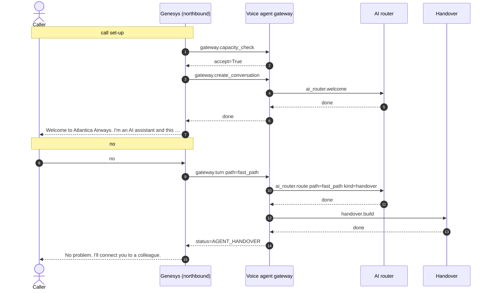

# Flow 06: Caller declines the AI assistant

The consent prompt comes first; "no" goes straight to a person.

**Demonstrates:** consent, AI disclosure is not interruptible, handover

**Result:** PASS · recorded 2026-10-11 17:48 · re-run with `python scripts/run_flow.py 06_consent_declined --trace`

## Setup

- reset PSS data, MCP lanes/saved copy/breaker, voice-agent sessions and lockouts

## Conversation

Genesys routed the call to **zingly**.

| # | Caller | Bot | Path → agent | Identity | ms |
|---|---|---|---|---|---|
| 0 | *(dials)* | Welcome to Atlantica Airways. I'm an AI assistant and this call may be recorded. Is that OK? | welcome (pre-rendered) | unknown | |
| 1 | no | No problem. I'll connect you to a colleague. | fast_path | unknown | 0.4 |

### Handover: Genesys screen-pop

Queue **General_Support**, queued (estimated wait 60 s).

```json
{
  "conversation_status": "AGENT_HANDOVER",
  "tenant_id": "atlantica",
  "conversation_id": "conv-387c89ef0d0d",
  "call_id": "gen-96145874f9",
  "routing": {
    "queue": "General_Support",
    "category": "general",
    "subcategory": "consent_declined",
    "priority": 0,
    "callback_eligible": true
  },
  "summary": "Caller unknown. Reason for handover: caller declined AI assistance.",
  "caller": {
    "number_masked": "+15******005",
    "identity_level": "unknown",
    "verified_by": null
  },
  "booking": null,
  "disruption": null,
  "attempted_actions": [],
  "context_ref": "9160ee63-d14b-4888-8ddd-7db18b199419",
  "genesys_participant_data": {
    "zingly.conversationStatus": "AGENT_HANDOVER",
    "zingly.category": "general",
    "zingly.subcategory": "consent_declined",
    "zingly.summary": "Caller unknown. Reason for handover: caller declined AI assistance.",
    "zingly.identityLevel": "unknown",
    "zingly.bookingRefMasked": "",
    "zingly.attemptedActions": "0",
    "zingly.contextRef": "9160ee63-d14b-4888-8ddd-7db18b199419"
  },
  "data_notes": []
}
```

### Sequence (built from the recorded spans)



### Traces

<details><summary>Call set-up</summary>

```text
[genesys] genesys: genesys.inbound_flow (10.8 ms) flow=Atlantica disruption line call_id=gen-96145874f9 caller=*********005 routed_to=zingly
  [voice-agent] gateway: gateway.capacity_check (3.4 ms) accept=True active=0 limit=500 breaker=closed
  [voice-agent] gateway: gateway.create_conversation (0.4 ms) call_id=gen-96145874f9 audio_id=atlantica:welcome:v1
    [voice-agent] ai-router: ai_router.welcome (0.2 ms)
```

</details>

<details><summary>Turn 1: “no”</summary>

```text
[genesys] genesys: genesys.caller_turn (3.8 ms) call_id=gen-96145874f9 status=AGENT_HANDOVER
  [voice-agent] gateway: gateway.turn (0.4 ms) turn=1 status=AGENT_HANDOVER path=fast_path identity=unknown
    [voice-agent] channel: channel.inbound (0.0 ms) channel=text kind=speech chars=2
    [voice-agent] ai-router: ai_router.route (0.1 ms) kind=handover path=fast_path handover=consent_declined
    [voice-agent] handover: handover.build (0.0 ms) category=general subcategory=consent_declined queue=General_Support attempted_actions=0
  [genesys] genesys: genesys.route_to_agent (0.0 ms) queue=General_Support wait_s=60 disposition=queued
```

</details>

## Components involved

| Process | Component | Operations seen in this run |
|---|---|---|
| `genesys` | genesys | `genesys.caller_turn`, `genesys.inbound_flow`, `genesys.route_to_agent` |
| `voice-agent` | ai-router | `ai_router.route`, `ai_router.welcome` |
| `voice-agent` | channel | `channel.inbound` |
| `voice-agent` | gateway | `gateway.capacity_check`, `gateway.create_conversation`, `gateway.turn` |
| `voice-agent` | handover | `handover.build` |

## Checks

- ✅ call 1: routed to zingly (got zingly)
- ✅ call 1 turn 1: call status AGENT_HANDOVER (got AGENT_HANDOVER)
- ✅ call 1 turn 1: handover subcategory = consent_declined (got consent_declined)
