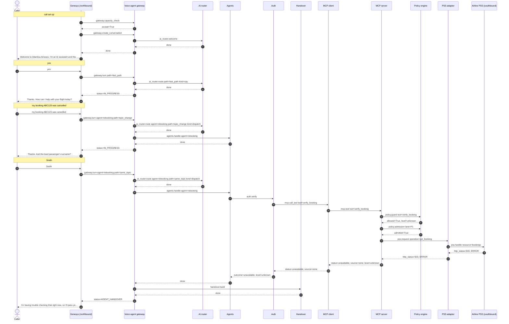

# Flow 07: Reservation system down, nothing saved

The PSS returns errors and nothing is pre-warmed. Verification cannot be checked, so no attempt is used up and the caller is handed over with the exact state and a callback offer.

**Demonstrates:** degraded mode - reservation system down, safe failure, callback offer

**Result:** PASS · recorded 2026-10-11 17:48 · re-run with `python scripts/run_flow.py 07_pss_down_handover --trace`

## Setup

- reset PSS data, MCP lanes/saved copy/breaker, voice-agent sessions and lockouts
- PSS fault injection: {'airline': 'atlantica', 'error_rate': 1.0}

## Conversation

Genesys routed the call to **zingly**.

| # | Caller | Bot | Path → agent | Identity | ms |
|---|---|---|---|---|---|
| 0 | *(dials)* | Welcome to Atlantica Airways. I'm an AI assistant and this call may be recorded. Is that OK? | welcome (pre-rendered) | unknown | |
| 1 | yes | Thanks. How can I help with your flight today? | fast_path | unknown | 0.3 |
| 2 | my booking ABC123 was cancelled | Thanks. And the lead passenger's surname? | topic_change → rebooking | unknown | 0.6 |
| 3 | Smith | I'm having trouble checking that right now, so I'll pass you to a colleague. | same_topic → rebooking | unknown | 94.6 |

### Handover: Genesys screen-pop

Queue **Disruption_Rebooking**, callback_offered (estimated wait 300 s).

```json
{
  "conversation_status": "AGENT_HANDOVER",
  "tenant_id": "atlantica",
  "conversation_id": "conv-ad7e46a79ae7",
  "call_id": "gen-e02af9d0b4",
  "routing": {
    "queue": "Disruption_Rebooking",
    "category": "rebooking",
    "subcategory": "verification_unavailable",
    "priority": 10,
    "callback_eligible": true
  },
  "summary": "Caller unknown. Reason for handover: reservation system could not be reached to verify. Tried: verify_identity -> unavailable.",
  "caller": {
    "number_masked": "+15******006",
    "identity_level": "unknown",
    "verified_by": null
  },
  "booking": null,
  "disruption": null,
  "attempted_actions": [
    {
      "action": "verify_identity",
      "result": "unavailable",
      "detail": "",
      "args": {},
      "at": 1791740882.0582688
    }
  ],
  "context_ref": "5a842586-f3b6-46cb-a6c3-0e4d6050e74b",
  "genesys_participant_data": {
    "zingly.conversationStatus": "AGENT_HANDOVER",
    "zingly.category": "rebooking",
    "zingly.subcategory": "verification_unavailable",
    "zingly.summary": "Caller unknown. Reason for handover: reservation system could not be reached to verify. Tried: verify_identity -> unavailable.",
    "zingly.identityLevel": "unknown",
    "zingly.bookingRefMasked": "",
    "zingly.attemptedActions": "1",
    "zingly.contextRef": "5a842586-f3b6-46cb-a6c3-0e4d6050e74b"
  },
  "data_notes": []
}
```

### Sequence (built from the recorded spans)



### Traces

<details><summary>Call set-up</summary>

```text
[genesys] genesys: genesys.inbound_flow (9.4 ms) flow=Atlantica disruption line call_id=gen-e02af9d0b4 caller=*********006 routed_to=zingly
  [voice-agent] gateway: gateway.capacity_check (3.1 ms) accept=True active=0 limit=500 breaker=closed
  [voice-agent] gateway: gateway.create_conversation (0.5 ms) call_id=gen-e02af9d0b4 audio_id=atlantica:welcome:v1
    [voice-agent] ai-router: ai_router.welcome (0.3 ms)
```

</details>

<details><summary>Turn 1: “yes”</summary>

```text
[genesys] genesys: genesys.caller_turn (3.6 ms) call_id=gen-e02af9d0b4 status=IN_PROGRESS
  [voice-agent] gateway: gateway.turn (0.3 ms) turn=1 status=IN_PROGRESS path=fast_path identity=unknown
    [voice-agent] channel: channel.inbound (0.0 ms) channel=text kind=speech chars=3
    [voice-agent] ai-router: ai_router.route (0.1 ms) kind=say path=fast_path
```

</details>

<details><summary>Turn 2: “my booking ABC123 was cancelled”</summary>

```text
[genesys] genesys: genesys.caller_turn (4.3 ms) call_id=gen-e02af9d0b4 status=IN_PROGRESS
  [voice-agent] gateway: gateway.turn (0.6 ms) turn=2 status=IN_PROGRESS path=topic_change agent=rebooking identity=unknown
    [voice-agent] channel: channel.inbound (0.0 ms) channel=text kind=speech chars=31
    [voice-agent] ai-router: ai_router.route (0.2 ms) kind=dispatch path=topic_change agent=rebooking
    [voice-agent] agents: agents.handle (0.0 ms) agent=rebooking next_question=surname
```

</details>

<details><summary>Turn 3: “Smith”</summary>

```text
[genesys] genesys: genesys.caller_turn (98.1 ms) call_id=gen-e02af9d0b4 status=AGENT_HANDOVER
  [voice-agent] gateway: gateway.turn (94.6 ms) turn=3 status=AGENT_HANDOVER path=same_topic agent=rebooking identity=unknown
    [voice-agent] channel: channel.inbound (0.0 ms) channel=text kind=speech chars=5
    [voice-agent] ai-router: ai_router.route (0.1 ms) active=rebooking pending=surname kind=dispatch path=same_topic agent=rebooking
    [voice-agent] agents: agents.handle (94.1 ms) agent=rebooking pending=surname handover=verification_unavailable
      [voice-agent] auth: auth.verify (94.0 ms) booking=****23 outcome=unavailable level=unknown attempts_left=3
        [voice-agent] mcp-client: mcp.call_tool (93.8 ms) tool=verify_booking identity=none status=unavailable source=none
          [mcp-server] mcp-server: mcp.tool (63.4 ms) tool=verify_booking level=unknown status=unavailable source=none detail=BackendUnavailable
            [mcp-server] policy: policy.guard (0.0 ms) tool=verify_booking level=unknown allowed=True
            [mcp-server] policy: policy.admission (0.0 ms) lane=P1 wait_budget_s=1.5 admitted=True waited_ms=0.0
            ✗ [mcp-server] pss-adapter: pss.request (62.8 ms) method=GET operation=get_booking http_status=503 error=BackendUnavailable
              ✗ [airline-pss] airline-pss: pss.handle (59.6 ms) airline=atlantica method=GET resource=bookings http_status=503 limit_rps=5
    [voice-agent] handover: handover.build (0.1 ms) category=rebooking subcategory=verification_unavailable queue=Disruption_Rebooking attempted_actions=1
  [genesys] genesys: genesys.route_to_agent (0.0 ms) queue=Disruption_Rebooking wait_s=300 disposition=callback_offered
```

</details>

## Components involved

| Process | Component | Operations seen in this run |
|---|---|---|
| `airline-pss` | airline-pss | `pss.handle` |
| `genesys` | genesys | `genesys.caller_turn`, `genesys.inbound_flow`, `genesys.route_to_agent` |
| `mcp-server` | mcp-server | `mcp.tool` |
| `mcp-server` | policy | `policy.admission`, `policy.guard` |
| `mcp-server` | pss-adapter | `pss.request` |
| `voice-agent` | agents | `agents.handle` |
| `voice-agent` | ai-router | `ai_router.route`, `ai_router.welcome` |
| `voice-agent` | auth | `auth.verify` |
| `voice-agent` | channel | `channel.inbound` |
| `voice-agent` | gateway | `gateway.capacity_check`, `gateway.create_conversation`, `gateway.turn` |
| `voice-agent` | handover | `handover.build` |
| `voice-agent` | mcp-client | `mcp.call_tool` |

## Checks

- ✅ call 1: routed to zingly (got zingly)
- ✅ call 1 turn 3: call status AGENT_HANDOVER (got AGENT_HANDOVER)
- ✅ call 1 turn 3: handover subcategory = verification_unavailable (got verification_unavailable)
- ✅ call 1 turn 3: handover disposition = callback_offered (got callback_offered)
