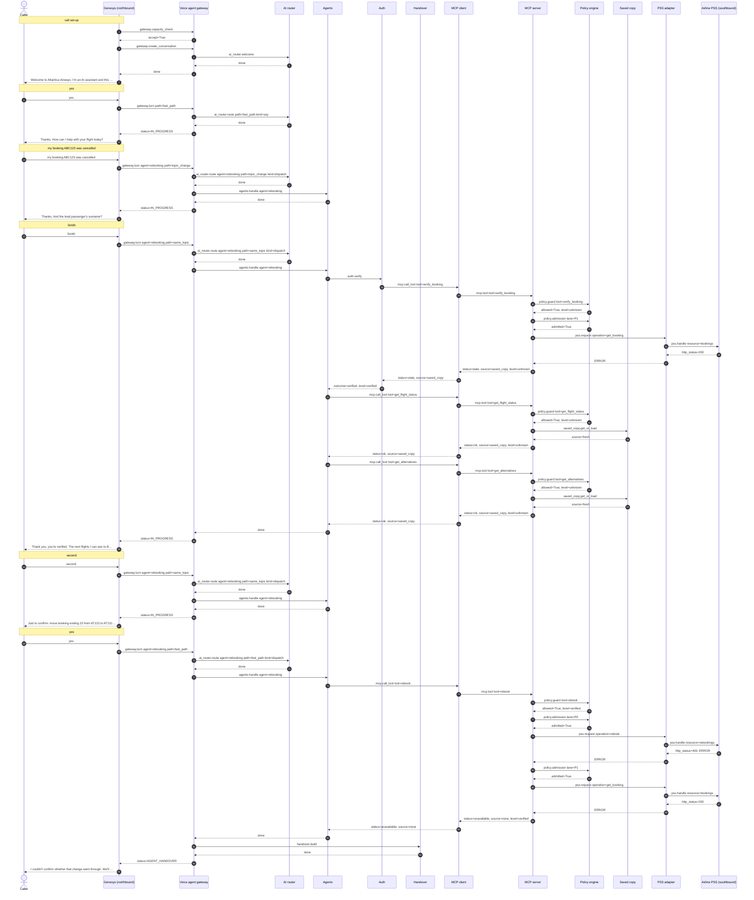

# Flow 08: Reservation system brownout, answered from the saved copy

After the disruption was pre-warmed the PSS becomes too slow (beyond the 2 s timeout). Verification and options are served from the saved copy and labelled "as of". The commit times out and the read-back times out too, so the outcome is unknown: the bot does not claim either way, hands over, and queues a reconciliation under the same idempotency key. When the PSS recovers the reconciliation confirms the booking exactly once.

**Demonstrates:** degraded mode - brownout, saved copy fallback, read-before-retry, idempotent reconciliation, handover

**Result:** PASS · recorded 2026-10-11 17:48 · re-run with `python scripts/run_flow.py 08_pss_brownout_saved_copy --trace`

## Setup

- reset PSS data, MCP lanes/saved copy/breaker, voice-agent sessions and lockouts
- disruption event for AT123: saved copy pre-warmed ({'flight': 'AT123', 'status': 'CANCELLED', 'bookings': 180, 'alternatives': 2, 'pss_requests': 3})
- PSS fault injection: {'airline': 'atlantica', 'extra_latency_ms': 2500}

## Conversation

Genesys routed the call to **zingly**.

| # | Caller | Bot | Path → agent | Identity | ms |
|---|---|---|---|---|---|
| 0 | *(dials)* | Welcome to Atlantica Airways. I'm an AI assistant and this call may be recorded. Is that OK? | welcome (pre-rendered) | unknown | |
| 1 | yes | Thanks. How can I help with your flight today? | fast_path | unknown | 0.3 |
| 2 | my booking ABC123 was cancelled | Thanks. And the lead passenger's surname? | topic_change → rebooking | unknown | 0.7 |
| 3 | Smith | Thank you, you're verified. The next flights I can see to Boston are 14:05 on AT127 and 19:40 on AT131. Which would you like: the first or the second? | same_topic → rebooking | verified | 2208.5 |
| 4 | second | Just to confirm: move booking ending 23 from AT123 to AT131, departing 19:40. Shall I go ahead? | same_topic → rebooking | verified | 0.6 |
| 5 | yes | I couldn't confirm whether that change went through. We'll finish checking in the background and text you the result. I'll pass you to a colleague now with everything we've done. | fast_path → rebooking | verified | 4059.5 |

### Handover: Genesys screen-pop

Queue **Disruption_Rebooking**, callback_offered (estimated wait 300 s).

```json
{
  "conversation_status": "AGENT_HANDOVER",
  "tenant_id": "atlantica",
  "conversation_id": "conv-a86b76707a36",
  "call_id": "gen-64c94c6630",
  "routing": {
    "queue": "Disruption_Rebooking",
    "category": "rebooking",
    "subcategory": "rebook_unconfirmed",
    "priority": 10,
    "callback_eligible": true
  },
  "summary": "Caller verified by booking_ref and surname. Booking A***23 on AT123. AT123 cancelled (weather). Reason for handover: rebook outcome unknown: rebook outcome unknown; reconciliation queued under the same idempotency key. Tried: verify_identity -> verified; get_alternatives -> ok; rebook AT131 -> unavailable (rebook outcome unknown; reconciliation queued under the same idempotency key).",
  "caller": {
    "number_masked": "+15******007",
    "identity_level": "verified",
    "verified_by": "booking_ref+surname"
  },
  "booking": {
    "ref_masked": "A***23",
    "flight": "AT123",
    "cabin": "economy"
  },
  "disruption": {
    "flight": "AT123",
    "status": "CANCELLED",
    "reason": "weather",
    "origin": "LHR",
    "destination": "BOS"
  },
  "attempted_actions": [
    {
      "action": "verify_identity",
      "result": "verified",
      "detail": "",
      "args": {},
      "at": 1791740893.5528066
    },
    {
      "action": "get_alternatives",
      "result": "ok",
      "detail": "",
      "args": {
        "origin": "LHR",
        "destination": "BOS"
      },
      "at": 1791740893.552809
    },
    {
      "action": "rebook",
      "result": "unavailable",
      "detail": "rebook outcome unknown; reconciliation queued under the same idempotency key",
      "args": {
        "to_flight": "AT131"
      },
      "at": 1791740893.55281
    }
  ],
  "context_ref": "6923051a-4aff-4a11-9d96-ab4435a263d7",
  "genesys_participant_data": {
    "zingly.conversationStatus": "AGENT_HANDOVER",
    "zingly.category": "rebooking",
    "zingly.subcategory": "rebook_unconfirmed",
    "zingly.summary": "Caller verified by booking_ref and surname. Booking A***23 on AT123. AT123 cancelled (weather). Reason for handover: rebook outcome unknown: rebook outcome unknown; reconciliation queued under the same idempotency key. Tried: verify_identity -> verified; get_alternatives -> ok; rebook AT131 -> unavailable (rebook outcome unknown; reconciliation queued under the same idempotency key).",
    "zingly.identityLevel": "verified",
    "zingly.bookingRefMasked": "A***23",
    "zingly.attemptedActions": "3",
    "zingly.contextRef": "6923051a-4aff-4a11-9d96-ab4435a263d7"
  },
  "data_notes": [
    "booking checked against saved copy as of 17:48"
  ]
}
```

### Sequence (built from the recorded spans)



### Traces

<details><summary>Call set-up</summary>

```text
[genesys] genesys: genesys.inbound_flow (13.4 ms) flow=Atlantica disruption line call_id=gen-64c94c6630 caller=*********007 routed_to=zingly
  [voice-agent] gateway: gateway.capacity_check (3.1 ms) accept=True active=0 limit=500 breaker=closed
  [voice-agent] gateway: gateway.create_conversation (0.4 ms) call_id=gen-64c94c6630 audio_id=atlantica:welcome:v1
    [voice-agent] ai-router: ai_router.welcome (0.2 ms)
```

</details>

<details><summary>Turn 1: “yes”</summary>

```text
[genesys] genesys: genesys.caller_turn (4.0 ms) call_id=gen-64c94c6630 status=IN_PROGRESS
  [voice-agent] gateway: gateway.turn (0.3 ms) turn=1 status=IN_PROGRESS path=fast_path identity=unknown
    [voice-agent] channel: channel.inbound (0.0 ms) channel=text kind=speech chars=3
    [voice-agent] ai-router: ai_router.route (0.0 ms) kind=say path=fast_path
```

</details>

<details><summary>Turn 2: “my booking ABC123 was cancelled”</summary>

```text
[genesys] genesys: genesys.caller_turn (4.6 ms) call_id=gen-64c94c6630 status=IN_PROGRESS
  [voice-agent] gateway: gateway.turn (0.7 ms) turn=2 status=IN_PROGRESS path=topic_change agent=rebooking identity=unknown
    [voice-agent] channel: channel.inbound (0.0 ms) channel=text kind=speech chars=31
    [voice-agent] ai-router: ai_router.route (0.2 ms) kind=dispatch path=topic_change agent=rebooking
    [voice-agent] agents: agents.handle (0.0 ms) agent=rebooking next_question=surname
```

</details>

<details><summary>Turn 3: “Smith”</summary>

```text
[genesys] genesys: genesys.caller_turn (2212.5 ms) call_id=gen-64c94c6630 status=IN_PROGRESS
  [voice-agent] gateway: gateway.turn (2208.5 ms) turn=3 status=IN_PROGRESS path=same_topic agent=rebooking identity=verified
    [voice-agent] channel: channel.inbound (0.0 ms) channel=text kind=speech chars=5
    [voice-agent] ai-router: ai_router.route (0.1 ms) active=rebooking pending=surname kind=dispatch path=same_topic agent=rebooking
    [voice-agent] agents: agents.handle (2208.0 ms) agent=rebooking pending=surname next_question=choose_option identity=verified
      [voice-agent] auth: auth.verify (2137.5 ms) booking=****23 outcome=verified level=verified
        [voice-agent] mcp-client: mcp.call_tool (2137.2 ms) tool=verify_booking identity=none status=stale source=saved_copy
          [mcp-server] mcp-server: mcp.tool (2104.7 ms) tool=verify_booking level=unknown status=stale source=saved_copy detail=BackendUnavailable
            [mcp-server] policy: policy.guard (0.0 ms) tool=verify_booking level=unknown allowed=True
            [mcp-server] policy: policy.admission (101.1 ms) lane=P1 wait_budget_s=1.5 admitted=True waited_ms=101.1
            ✗ [mcp-server] pss-adapter: pss.request (2003.0 ms) method=GET operation=get_booking error=ReadTimeout
              [airline-pss] airline-pss: pss.handle (2598.4 ms) airline=atlantica method=GET resource=bookings http_status=200 limit_rps=5
      [voice-agent] mcp-client: mcp.call_tool (35.9 ms) tool=get_flight_status identity=none status=ok source=saved_copy
        [mcp-server] mcp-server: mcp.tool (0.3 ms) tool=get_flight_status level=unknown status=ok source=saved_copy
          [mcp-server] policy: policy.guard (0.0 ms) tool=get_flight_status level=unknown allowed=True
          [mcp-server] saved-copy: saved_copy.get_or_load (0.0 ms) key=flight source=fresh
      [voice-agent] mcp-client: mcp.call_tool (33.8 ms) tool=get_alternatives identity=none status=ok source=saved_copy
        [mcp-server] mcp-server: mcp.tool (0.3 ms) tool=get_alternatives level=unknown status=ok source=saved_copy
          [mcp-server] policy: policy.guard (0.0 ms) tool=get_alternatives level=unknown allowed=True
          [mcp-server] saved-copy: saved_copy.get_or_load (0.0 ms) key=alts source=fresh
```

</details>

<details><summary>Turn 4: “second”</summary>

```text
[genesys] genesys: genesys.caller_turn (4.3 ms) call_id=gen-64c94c6630 status=IN_PROGRESS
  [voice-agent] gateway: gateway.turn (0.6 ms) turn=4 status=IN_PROGRESS path=same_topic agent=rebooking identity=verified
    [voice-agent] channel: channel.inbound (0.0 ms) channel=text kind=speech chars=6
    [voice-agent] ai-router: ai_router.route (0.1 ms) active=rebooking pending=choose_option kind=dispatch path=same_topic agent=rebooking
    [voice-agent] agents: agents.handle (0.1 ms) agent=rebooking pending=choose_option next_question=confirm_rebook
```

</details>

<details><summary>Turn 5: “yes”</summary>

```text
[genesys] genesys: genesys.caller_turn (4064.6 ms) call_id=gen-64c94c6630 status=AGENT_HANDOVER
  [voice-agent] gateway: gateway.turn (4059.5 ms) turn=5 status=AGENT_HANDOVER path=fast_path agent=rebooking identity=verified
    [voice-agent] channel: channel.inbound (0.0 ms) channel=text kind=speech chars=3
    [voice-agent] ai-router: ai_router.route (0.1 ms) active=rebooking pending=confirm_rebook kind=dispatch path=fast_path agent=rebooking yes_no=yes
    [voice-agent] agents: agents.handle (4058.7 ms) agent=rebooking pending=confirm_rebook handover=rebook_unconfirmed
      [voice-agent] mcp-client: mcp.call_tool (4058.3 ms) tool=rebook identity=token status=unavailable source=none
        [mcp-server] mcp-server: mcp.tool (4017.3 ms) tool=rebook level=verified status=unavailable source=none detail=rebook outcome unknown; reconciliation queued under the same idempotency key
          [mcp-server] policy: policy.guard (0.0 ms) tool=rebook level=verified allowed=True
          [mcp-server] policy: policy.admission (0.1 ms) lane=P0 wait_budget_s=3.0 admitted=True waited_ms=0.0
          ✗ [mcp-server] pss-adapter: pss.request (2007.6 ms) method=POST operation=rebook error=ReadTimeout
            ✗ [airline-pss] airline-pss: pss.handle (2542.6 ms) airline=atlantica method=POST resource=rebookings http_status=400 limit_rps=5
          [mcp-server] policy: policy.admission (0.0 ms) lane=P1 wait_budget_s=1.5 admitted=True waited_ms=0.0
          ✗ [mcp-server] pss-adapter: pss.request (2006.3 ms) method=GET operation=get_booking error=ReadTimeout
            [airline-pss] airline-pss: pss.handle (2596.8 ms) airline=atlantica method=GET resource=bookings http_status=200 limit_rps=5
    [voice-agent] handover: handover.build (0.1 ms) category=rebooking subcategory=rebook_unconfirmed queue=Disruption_Rebooking attempted_actions=3
  [genesys] genesys: genesys.route_to_agent (0.0 ms) queue=Disruption_Rebooking wait_s=300 disposition=callback_offered
```

</details>

## Background work during this flow

<details><summary>gateway.disruption_event (5065 ms)</summary>

```text
[voice-agent] gateway: gateway.disruption_event (5064.5 ms) flight=AT123
  [mcp-server] mcp-server: mcp.prewarm (5060.2 ms) flight=AT123
    [mcp-server] policy: policy.admission (0.1 ms) lane=P3 wait_budget_s=10 admitted=True waited_ms=0.0
    [mcp-server] pss-adapter: pss.request (83.1 ms) method=GET operation=get_flight http_status=200
      [airline-pss] airline-pss: pss.handle (79.2 ms) airline=atlantica method=GET resource=flights http_status=200 limit_rps=5
    [mcp-server] policy: policy.admission (2417.1 ms) lane=P3 wait_budget_s=10 admitted=True waited_ms=2417.0
    [mcp-server] pss-adapter: pss.request (64.1 ms) method=GET operation=get_passenger_list http_status=200
      [airline-pss] airline-pss: pss.handle (59.9 ms) airline=atlantica method=GET resource=flights http_status=200 limit_rps=5
    [mcp-server] policy: policy.admission (2435.8 ms) lane=P3 wait_budget_s=10 admitted=True waited_ms=2435.7
    [mcp-server] pss-adapter: pss.request (58.2 ms) method=GET operation=get_alternatives http_status=200
      [airline-pss] airline-pss: pss.handle (53.4 ms) airline=atlantica method=GET resource=alternatives http_status=200 limit_rps=5
```

</details>

<details><summary>mcp.drain_deferred (78 ms)</summary>

```text
[mcp-server] mcp-server: mcp.drain_deferred (77.7 ms)
  [mcp-server] mcp-server: mcp.deferred_commit (77.6 ms) booking=A***23 to_flight=AT131 attempt=1 outcome=confirmed
    [mcp-server] policy: policy.admission (0.1 ms) lane=P0 wait_budget_s=1.0 admitted=True waited_ms=0.0
    [mcp-server] pss-adapter: pss.request (77.0 ms) method=POST operation=rebook http_status=200
      [airline-pss] airline-pss: pss.handle (71.0 ms) airline=atlantica method=POST resource=rebookings http_status=200 limit_rps=5
```

</details>

## Components involved

| Process | Component | Operations seen in this run |
|---|---|---|
| `airline-pss` | airline-pss | `pss.handle` |
| `genesys` | genesys | `genesys.caller_turn`, `genesys.inbound_flow`, `genesys.route_to_agent` |
| `mcp-server` | mcp-server | `mcp.deferred_commit`, `mcp.drain_deferred`, `mcp.prewarm`, `mcp.tool` |
| `mcp-server` | policy | `policy.admission`, `policy.guard` |
| `mcp-server` | pss-adapter | `pss.request` |
| `mcp-server` | saved-copy | `saved_copy.get_or_load` |
| `voice-agent` | agents | `agents.handle` |
| `voice-agent` | ai-router | `ai_router.route`, `ai_router.welcome` |
| `voice-agent` | auth | `auth.verify` |
| `voice-agent` | channel | `channel.inbound` |
| `voice-agent` | gateway | `gateway.capacity_check`, `gateway.create_conversation`, `gateway.disruption_event`, `gateway.turn` |
| `voice-agent` | handover | `handover.build` |
| `voice-agent` | mcp-client | `mcp.call_tool` |

## Checks

- ✅ call 1: routed to zingly (got zingly)
- ✅ call 1 turn 3: identity = verified (got verified)
- ✅ call 1 turn 3: reply contains '14:05'
- ✅ call 1 turn 5: call status AGENT_HANDOVER (got AGENT_HANDOVER)
- ✅ call 1 turn 5: handover subcategory = rebook_unconfirmed (got rebook_unconfirmed)
- ✅ check: deferred commits confirmed ≥ 1 (got {'confirmed': 1})
- ✅ check: PSS booking ABC123 on AT131 (got AT131)
