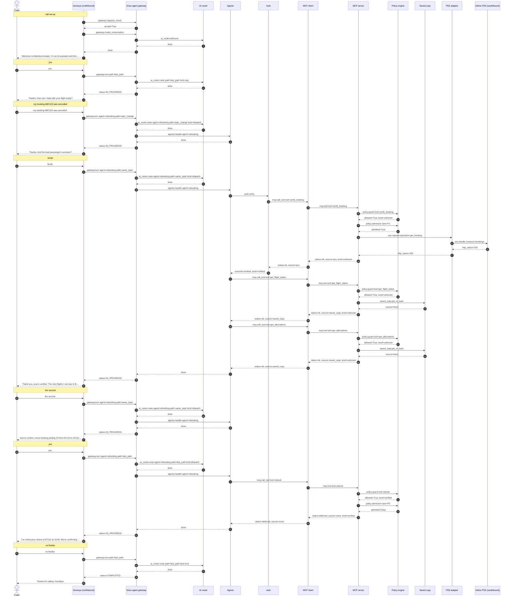

# Flow 09: P0 lane saturated, the choice becomes a deferred commit

The booking lane P0 is saturated (paused here to make it deterministic). Instead of an error the caller hears the deferred-commit wording; the MCP server commits later under the same idempotency key and the booking really moves.

**Demonstrates:** priority lanes, P0 fallback, deferred commit, idempotency key

**Result:** PASS · recorded 2026-10-11 17:48 · re-run with `python scripts/run_flow.py 09_deferred_commit --trace`

## Setup

- reset PSS data, MCP lanes/saved copy/breaker, voice-agent sessions and lockouts
- disruption event for AT123: saved copy pre-warmed ({'flight': 'AT123', 'status': 'CANCELLED', 'bookings': 180, 'alternatives': 2, 'pss_requests': 3})

## Conversation

Genesys routed the call to **zingly**.

| # | Caller | Bot | Path → agent | Identity | ms |
|---|---|---|---|---|---|
| 0 | *(dials)* | Welcome to Atlantica Airways. I'm an AI assistant and this call may be recorded. Is that OK? | welcome (pre-rendered) | unknown | |
| 1 | yes | Thanks. How can I help with your flight today? | fast_path | unknown | 0.3 |
| 2 | my booking ABC123 was cancelled | Thanks. And the lead passenger's surname? | topic_change → rebooking | unknown | 0.4 |
| 3 | Smith | Thank you, you're verified. The next flights I can see to Boston are 14:05 on AT127 and 19:40 on AT131. Which would you like: the first or the second? | same_topic → rebooking | verified | 247.7 |
| 4 | the second | Just to confirm: move booking ending 23 from AT123 to AT131, departing 19:40. Shall I go ahead? | same_topic → rebooking | verified | 0.5 |
| 5 | yes | I've noted your choice of AT131 at 19:40. We're confirming it now, and you'll get a text within 30 minutes. Is there anything else I can help with? | fast_path → rebooking | verified | 3032.5 |
| 6 | no thanks | Thanks for calling. Goodbye. | fast_path | verified | 0.4 |

### Sequence (built from the recorded spans)



### Traces

<details><summary>Call set-up</summary>

```text
[genesys] genesys: genesys.inbound_flow (9.9 ms) flow=Atlantica disruption line call_id=gen-defaf206e6 caller=*********008 routed_to=zingly
  [voice-agent] gateway: gateway.capacity_check (2.5 ms) accept=True active=0 limit=500 breaker=closed
  [voice-agent] gateway: gateway.create_conversation (0.4 ms) call_id=gen-defaf206e6 audio_id=atlantica:welcome:v1
    [voice-agent] ai-router: ai_router.welcome (0.2 ms)
```

</details>

<details><summary>Turn 1: “yes”</summary>

```text
[genesys] genesys: genesys.caller_turn (3.2 ms) call_id=gen-defaf206e6 status=IN_PROGRESS
  [voice-agent] gateway: gateway.turn (0.3 ms) turn=1 status=IN_PROGRESS path=fast_path identity=unknown
    [voice-agent] channel: channel.inbound (0.0 ms) channel=text kind=speech chars=3
    [voice-agent] ai-router: ai_router.route (0.0 ms) kind=say path=fast_path
```

</details>

<details><summary>Turn 2: “my booking ABC123 was cancelled”</summary>

```text
[genesys] genesys: genesys.caller_turn (3.1 ms) call_id=gen-defaf206e6 status=IN_PROGRESS
  [voice-agent] gateway: gateway.turn (0.5 ms) turn=2 status=IN_PROGRESS path=topic_change agent=rebooking identity=unknown
    [voice-agent] channel: channel.inbound (0.0 ms) channel=text kind=speech chars=31
    [voice-agent] ai-router: ai_router.route (0.1 ms) kind=dispatch path=topic_change agent=rebooking
    [voice-agent] agents: agents.handle (0.0 ms) agent=rebooking next_question=surname
```

</details>

<details><summary>Turn 3: “Smith”</summary>

```text
[genesys] genesys: genesys.caller_turn (250.9 ms) call_id=gen-defaf206e6 status=IN_PROGRESS
  [voice-agent] gateway: gateway.turn (247.7 ms) turn=3 status=IN_PROGRESS path=same_topic agent=rebooking identity=verified
    [voice-agent] channel: channel.inbound (0.0 ms) channel=text kind=speech chars=5
    [voice-agent] ai-router: ai_router.route (0.1 ms) active=rebooking pending=surname kind=dispatch path=same_topic agent=rebooking
    [voice-agent] agents: agents.handle (247.2 ms) agent=rebooking pending=surname next_question=choose_option identity=verified
      [voice-agent] auth: auth.verify (179.6 ms) booking=****23 outcome=verified level=verified
        [voice-agent] mcp-client: mcp.call_tool (179.2 ms) tool=verify_booking identity=none status=ok source=pss
          [mcp-server] mcp-server: mcp.tool (148.8 ms) tool=verify_booking level=unknown status=ok source=pss
            [mcp-server] policy: policy.guard (0.0 ms) tool=verify_booking level=unknown allowed=True
            [mcp-server] policy: policy.admission (75.0 ms) lane=P1 wait_budget_s=1.5 admitted=True waited_ms=74.9
            [mcp-server] pss-adapter: pss.request (73.1 ms) method=GET operation=get_booking http_status=200
              [airline-pss] airline-pss: pss.handle (69.1 ms) airline=atlantica method=GET resource=bookings http_status=200 limit_rps=5
      [voice-agent] mcp-client: mcp.call_tool (34.5 ms) tool=get_flight_status identity=none status=ok source=saved_copy
        [mcp-server] mcp-server: mcp.tool (0.4 ms) tool=get_flight_status level=unknown status=ok source=saved_copy
          [mcp-server] policy: policy.guard (0.0 ms) tool=get_flight_status level=unknown allowed=True
          [mcp-server] saved-copy: saved_copy.get_or_load (0.0 ms) key=flight source=fresh
      [voice-agent] mcp-client: mcp.call_tool (32.6 ms) tool=get_alternatives identity=none status=ok source=saved_copy
        [mcp-server] mcp-server: mcp.tool (0.4 ms) tool=get_alternatives level=unknown status=ok source=saved_copy
          [mcp-server] policy: policy.guard (0.0 ms) tool=get_alternatives level=unknown allowed=True
          [mcp-server] saved-copy: saved_copy.get_or_load (0.0 ms) key=alts source=fresh
```

</details>

<details><summary>Turn 4: “the second”</summary>

```text
[genesys] genesys: genesys.caller_turn (3.7 ms) call_id=gen-defaf206e6 status=IN_PROGRESS
  [voice-agent] gateway: gateway.turn (0.5 ms) turn=4 status=IN_PROGRESS path=same_topic agent=rebooking identity=verified
    [voice-agent] channel: channel.inbound (0.0 ms) channel=text kind=speech chars=10
    [voice-agent] ai-router: ai_router.route (0.1 ms) active=rebooking pending=choose_option kind=dispatch path=same_topic agent=rebooking
    [voice-agent] agents: agents.handle (0.0 ms) agent=rebooking pending=choose_option next_question=confirm_rebook
```

</details>

<details><summary>Turn 5: “yes”</summary>

```text
[genesys] genesys: genesys.caller_turn (3036.0 ms) call_id=gen-defaf206e6 status=IN_PROGRESS
  [voice-agent] gateway: gateway.turn (3032.5 ms) turn=5 status=IN_PROGRESS path=fast_path agent=rebooking identity=verified
    [voice-agent] channel: channel.inbound (0.0 ms) channel=text kind=speech chars=3
    [voice-agent] ai-router: ai_router.route (0.1 ms) active=rebooking pending=confirm_rebook kind=dispatch path=fast_path agent=rebooking yes_no=yes
    [voice-agent] agents: agents.handle (3032.1 ms) agent=rebooking pending=confirm_rebook done=True
      [voice-agent] mcp-client: mcp.call_tool (3031.9 ms) tool=rebook identity=token status=deferred source=none
        [mcp-server] mcp-server: mcp.tool (3001.7 ms) tool=rebook level=verified status=deferred source=none detail=LaneFull
          [mcp-server] policy: policy.guard (0.0 ms) tool=rebook level=verified allowed=True
          [mcp-server] policy: policy.admission (3001.3 ms) lane=P0 wait_budget_s=3.0 admitted=False waited_ms=3001.3
```

</details>

<details><summary>Turn 6: “no thanks”</summary>

```text
[genesys] genesys: genesys.caller_turn (3.3 ms) call_id=gen-defaf206e6 status=COMPLETED
  [voice-agent] gateway: gateway.turn (0.4 ms) turn=6 status=COMPLETED path=fast_path identity=verified
    [voice-agent] channel: channel.inbound (0.0 ms) channel=text kind=speech chars=9
    [voice-agent] ai-router: ai_router.route (0.1 ms) kind=end path=fast_path
```

</details>

## Background work during this flow

<details><summary>gateway.disruption_event (5118 ms)</summary>

```text
[voice-agent] gateway: gateway.disruption_event (5117.6 ms) flight=AT123
  [mcp-server] mcp-server: mcp.prewarm (5113.2 ms) flight=AT123
    [mcp-server] policy: policy.admission (0.1 ms) lane=P3 wait_budget_s=10 admitted=True waited_ms=0.0
    [mcp-server] pss-adapter: pss.request (80.5 ms) method=GET operation=get_flight http_status=200
      [airline-pss] airline-pss: pss.handle (75.2 ms) airline=atlantica method=GET resource=flights http_status=200 limit_rps=5
    [mcp-server] policy: policy.admission (2419.7 ms) lane=P3 wait_budget_s=10 admitted=True waited_ms=2419.6
    [mcp-server] pss-adapter: pss.request (83.9 ms) method=GET operation=get_passenger_list http_status=200
      [airline-pss] airline-pss: pss.handle (78.5 ms) airline=atlantica method=GET resource=flights http_status=200 limit_rps=5
    [mcp-server] policy: policy.admission (2416.3 ms) lane=P3 wait_budget_s=10 admitted=True waited_ms=2416.2
    [mcp-server] pss-adapter: pss.request (110.1 ms) method=GET operation=get_alternatives http_status=200
      [airline-pss] airline-pss: pss.handle (106.3 ms) airline=atlantica method=GET resource=alternatives http_status=200 limit_rps=5
```

</details>

<details><summary>mcp.drain_deferred (859 ms)</summary>

```text
[mcp-server] mcp-server: mcp.drain_deferred (859.1 ms)
  [mcp-server] mcp-server: mcp.deferred_commit (859.0 ms) booking=A***23 to_flight=AT131 attempt=1 outcome=confirmed
    [mcp-server] policy: policy.admission (774.2 ms) lane=P0 wait_budget_s=1.0 admitted=True waited_ms=774.2
    [mcp-server] pss-adapter: pss.request (84.3 ms) method=POST operation=rebook http_status=200
      [airline-pss] airline-pss: pss.handle (79.8 ms) airline=atlantica method=POST resource=rebookings http_status=200 limit_rps=5
```

</details>

## Components involved

| Process | Component | Operations seen in this run |
|---|---|---|
| `airline-pss` | airline-pss | `pss.handle` |
| `genesys` | genesys | `genesys.caller_turn`, `genesys.inbound_flow` |
| `mcp-server` | mcp-server | `mcp.deferred_commit`, `mcp.drain_deferred`, `mcp.prewarm`, `mcp.tool` |
| `mcp-server` | policy | `policy.admission`, `policy.guard` |
| `mcp-server` | pss-adapter | `pss.request` |
| `mcp-server` | saved-copy | `saved_copy.get_or_load` |
| `voice-agent` | agents | `agents.handle` |
| `voice-agent` | ai-router | `ai_router.route`, `ai_router.welcome` |
| `voice-agent` | auth | `auth.verify` |
| `voice-agent` | channel | `channel.inbound` |
| `voice-agent` | gateway | `gateway.capacity_check`, `gateway.create_conversation`, `gateway.disruption_event`, `gateway.turn` |
| `voice-agent` | mcp-client | `mcp.call_tool` |

## Checks

- ✅ call 1: routed to zingly (got zingly)
- ✅ call 1 turn 6: reply contains 'within 30 minutes'
- ✅ call 1 turn 7: call status COMPLETED (got COMPLETED)
- ✅ check: deferred commits confirmed ≥ 1 (got {'confirmed': 1})
- ✅ check: PSS booking ABC123 on AT131 (got AT131)
