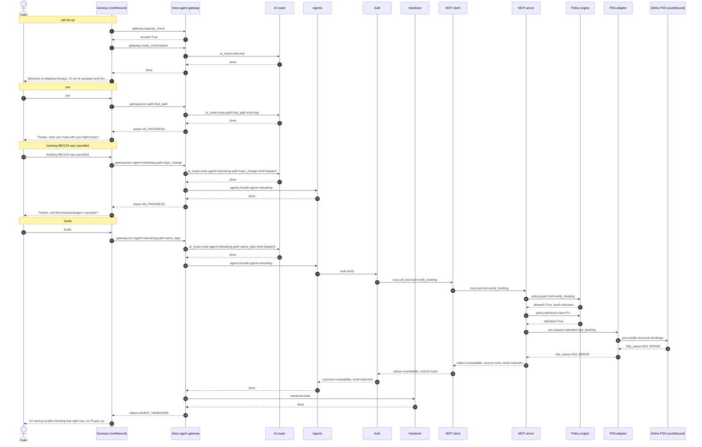
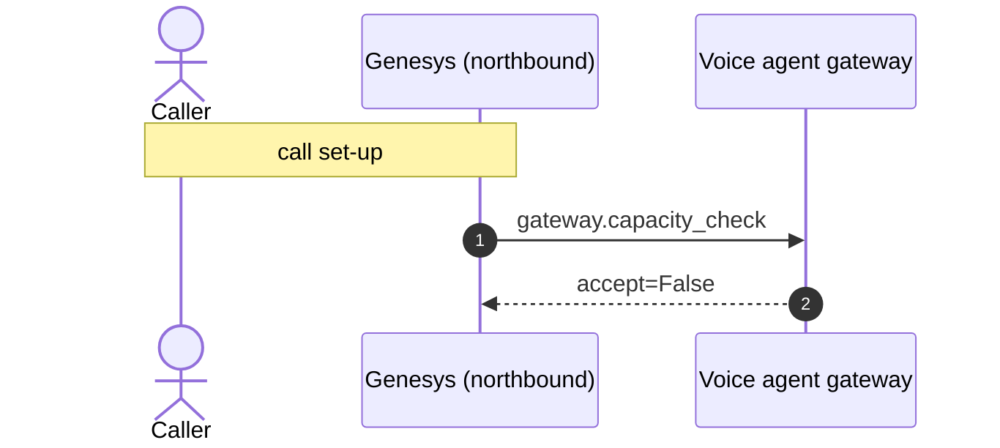

# Flow 10: Failing reservation system opens the breaker; Genesys stops sending calls to the bot

Five calls in a row hit PSS errors. The circuit breaker in the MCP server opens, the Genesys capacity check sees it and routes the next caller straight to a person.

**Demonstrates:** circuit breaker, capacity check, bot is never the only path

**Result:** PASS · recorded 2026-10-11 17:48 · re-run with `python scripts/run_flow.py 10_breaker_open_capacity --trace`

## Setup

- reset PSS data, MCP lanes/saved copy/breaker, voice-agent sessions and lockouts
- PSS fault injection: {'airline': 'atlantica', 'error_rate': 1.0}

## Call 1: +15550000101 dials +448000001234

Genesys routed the call to **zingly**.

| # | Caller | Bot | Path → agent | Identity | ms |
|---|---|---|---|---|---|
| 0 | *(dials)* | Welcome to Atlantica Airways. I'm an AI assistant and this call may be recorded. Is that OK? | welcome (pre-rendered) | unknown | |
| 1 | yes | Thanks. How can I help with your flight today? | fast_path | unknown | 0.5 |
| 2 | booking ABC123 was cancelled | Thanks. And the lead passenger's surname? | topic_change → rebooking | unknown | 0.7 |
| 3 | Smith | I'm having trouble checking that right now, so I'll pass you to a colleague. | same_topic → rebooking | unknown | 89.3 |

### Handover: Genesys screen-pop

Queue **Disruption_Rebooking**, callback_offered (estimated wait 300 s).

```json
{
  "conversation_status": "AGENT_HANDOVER",
  "tenant_id": "atlantica",
  "conversation_id": "conv-7879479d5438",
  "call_id": "gen-5ac7c2c655",
  "routing": {
    "queue": "Disruption_Rebooking",
    "category": "rebooking",
    "subcategory": "verification_unavailable",
    "priority": 10,
    "callback_eligible": true
  },
  "summary": "Caller unknown. Reason for handover: reservation system could not be reached to verify. Tried: verify_identity -> unavailable.",
  "caller": {
    "number_masked": "+15******101",
    "identity_level": "unknown",
    "verified_by": null
  },
  "booking": null,
  "disruption": null,
  "attempted_actions": [
    {
      "action": "verify_identity",
      "result": "unavailable",
      "detail": "",
      "args": {},
      "at": 1791740918.3407192
    }
  ],
  "context_ref": "fcf38093-669b-4207-951c-aa60fcb90ddb",
  "genesys_participant_data": {
    "zingly.conversationStatus": "AGENT_HANDOVER",
    "zingly.category": "rebooking",
    "zingly.subcategory": "verification_unavailable",
    "zingly.summary": "Caller unknown. Reason for handover: reservation system could not be reached to verify. Tried: verify_identity -> unavailable.",
    "zingly.identityLevel": "unknown",
    "zingly.bookingRefMasked": "",
    "zingly.attemptedActions": "1",
    "zingly.contextRef": "fcf38093-669b-4207-951c-aa60fcb90ddb"
  },
  "data_notes": []
}
```

### Sequence (built from the recorded spans)



### Traces

<details><summary>Call set-up</summary>

```text
[genesys] genesys: genesys.inbound_flow (13.6 ms) flow=Atlantica disruption line call_id=gen-5ac7c2c655 caller=*********101 routed_to=zingly
  [voice-agent] gateway: gateway.capacity_check (4.8 ms) accept=True active=0 limit=500 breaker=closed
  [voice-agent] gateway: gateway.create_conversation (0.6 ms) call_id=gen-5ac7c2c655 audio_id=atlantica:welcome:v1
    [voice-agent] ai-router: ai_router.welcome (0.3 ms)
```

</details>

<details><summary>Turn 1: “yes”</summary>

```text
[genesys] genesys: genesys.caller_turn (3.9 ms) call_id=gen-5ac7c2c655 status=IN_PROGRESS
  [voice-agent] gateway: gateway.turn (0.5 ms) turn=1 status=IN_PROGRESS path=fast_path identity=unknown
    [voice-agent] channel: channel.inbound (0.1 ms) channel=text kind=speech chars=3
    [voice-agent] ai-router: ai_router.route (0.1 ms) kind=say path=fast_path
```

</details>

<details><summary>Turn 2: “booking ABC123 was cancelled”</summary>

```text
[genesys] genesys: genesys.caller_turn (4.3 ms) call_id=gen-5ac7c2c655 status=IN_PROGRESS
  [voice-agent] gateway: gateway.turn (0.7 ms) turn=2 status=IN_PROGRESS path=topic_change agent=rebooking identity=unknown
    [voice-agent] channel: channel.inbound (0.0 ms) channel=text kind=speech chars=28
    [voice-agent] ai-router: ai_router.route (0.2 ms) kind=dispatch path=topic_change agent=rebooking
    [voice-agent] agents: agents.handle (0.0 ms) agent=rebooking next_question=surname
```

</details>

<details><summary>Turn 3: “Smith”</summary>

```text
[genesys] genesys: genesys.caller_turn (93.4 ms) call_id=gen-5ac7c2c655 status=AGENT_HANDOVER
  [voice-agent] gateway: gateway.turn (89.3 ms) turn=3 status=AGENT_HANDOVER path=same_topic agent=rebooking identity=unknown
    [voice-agent] channel: channel.inbound (0.0 ms) channel=text kind=speech chars=5
    [voice-agent] ai-router: ai_router.route (0.1 ms) active=rebooking pending=surname kind=dispatch path=same_topic agent=rebooking
    [voice-agent] agents: agents.handle (88.6 ms) agent=rebooking pending=surname handover=verification_unavailable
      [voice-agent] auth: auth.verify (88.5 ms) booking=****23 outcome=unavailable level=unknown attempts_left=3
        [voice-agent] mcp-client: mcp.call_tool (88.3 ms) tool=verify_booking identity=none status=unavailable source=none
          [mcp-server] mcp-server: mcp.tool (51.8 ms) tool=verify_booking level=unknown status=unavailable source=none detail=BackendUnavailable
            [mcp-server] policy: policy.guard (0.0 ms) tool=verify_booking level=unknown allowed=True
            [mcp-server] policy: policy.admission (0.0 ms) lane=P1 wait_budget_s=1.5 admitted=True waited_ms=0.0
            ✗ [mcp-server] pss-adapter: pss.request (51.1 ms) method=GET operation=get_booking http_status=503 error=BackendUnavailable
              ✗ [airline-pss] airline-pss: pss.handle (45.6 ms) airline=atlantica method=GET resource=bookings http_status=503 limit_rps=5
    [voice-agent] handover: handover.build (0.1 ms) category=rebooking subcategory=verification_unavailable queue=Disruption_Rebooking attempted_actions=1
  [genesys] genesys: genesys.route_to_agent (0.0 ms) queue=Disruption_Rebooking wait_s=300 disposition=callback_offered
```

</details>

## Call 2: +15550000102 dials +448000001234

Genesys routed the call to **zingly**.

| # | Caller | Bot | Path → agent | Identity | ms |
|---|---|---|---|---|---|
| 0 | *(dials)* | Welcome to Atlantica Airways. I'm an AI assistant and this call may be recorded. Is that OK? | welcome (pre-rendered) | unknown | |
| 1 | yes | Thanks. How can I help with your flight today? | fast_path | unknown | 0.4 |
| 2 | booking ABC123 was cancelled | Thanks. And the lead passenger's surname? | topic_change → rebooking | unknown | 0.9 |
| 3 | Smith | I'm having trouble checking that right now, so I'll pass you to a colleague. | same_topic → rebooking | unknown | 292.9 |

### Handover: Genesys screen-pop

Queue **Disruption_Rebooking**, callback_offered (estimated wait 300 s).

```json
{
  "conversation_status": "AGENT_HANDOVER",
  "tenant_id": "atlantica",
  "conversation_id": "conv-8e623885c7f0",
  "call_id": "gen-963361f5e1",
  "routing": {
    "queue": "Disruption_Rebooking",
    "category": "rebooking",
    "subcategory": "verification_unavailable",
    "priority": 10,
    "callback_eligible": true
  },
  "summary": "Caller unknown. Reason for handover: reservation system could not be reached to verify. Tried: verify_identity -> unavailable.",
  "caller": {
    "number_masked": "+15******102",
    "identity_level": "unknown",
    "verified_by": null
  },
  "booking": null,
  "disruption": null,
  "attempted_actions": [
    {
      "action": "verify_identity",
      "result": "unavailable",
      "detail": "",
      "args": {},
      "at": 1791740918.683908
    }
  ],
  "context_ref": "3c5898f3-453a-4a2b-819f-56a09475bb5a",
  "genesys_participant_data": {
    "zingly.conversationStatus": "AGENT_HANDOVER",
    "zingly.category": "rebooking",
    "zingly.subcategory": "verification_unavailable",
    "zingly.summary": "Caller unknown. Reason for handover: reservation system could not be reached to verify. Tried: verify_identity -> unavailable.",
    "zingly.identityLevel": "unknown",
    "zingly.bookingRefMasked": "",
    "zingly.attemptedActions": "1",
    "zingly.contextRef": "3c5898f3-453a-4a2b-819f-56a09475bb5a"
  },
  "data_notes": []
}
```

### Sequence (built from the recorded spans)


### Traces

<details><summary>Call set-up</summary>

```text
[genesys] genesys: genesys.inbound_flow (9.2 ms) flow=Atlantica disruption line call_id=gen-963361f5e1 caller=*********102 routed_to=zingly
  [voice-agent] gateway: gateway.capacity_check (2.6 ms) accept=True active=0 limit=500 breaker=closed
  [voice-agent] gateway: gateway.create_conversation (0.3 ms) call_id=gen-963361f5e1 audio_id=atlantica:welcome:v1
    [voice-agent] ai-router: ai_router.welcome (0.2 ms)
```

</details>

<details><summary>Turn 1: “yes”</summary>

```text
[genesys] genesys: genesys.caller_turn (3.9 ms) call_id=gen-963361f5e1 status=IN_PROGRESS
  [voice-agent] gateway: gateway.turn (0.5 ms) turn=1 status=IN_PROGRESS path=fast_path identity=unknown
    [voice-agent] channel: channel.inbound (0.0 ms) channel=text kind=speech chars=3
    [voice-agent] ai-router: ai_router.route (0.1 ms) kind=say path=fast_path
```

</details>

<details><summary>Turn 2: “booking ABC123 was cancelled”</summary>

```text
[genesys] genesys: genesys.caller_turn (4.4 ms) call_id=gen-963361f5e1 status=IN_PROGRESS
  [voice-agent] gateway: gateway.turn (0.9 ms) turn=2 status=IN_PROGRESS path=topic_change agent=rebooking identity=unknown
    [voice-agent] channel: channel.inbound (0.0 ms) channel=text kind=speech chars=28
    [voice-agent] ai-router: ai_router.route (0.2 ms) kind=dispatch path=topic_change agent=rebooking
    [voice-agent] agents: agents.handle (0.1 ms) agent=rebooking next_question=surname
```

</details>

<details><summary>Turn 3: “Smith”</summary>

```text
[genesys] genesys: genesys.caller_turn (296.8 ms) call_id=gen-963361f5e1 status=AGENT_HANDOVER
  [voice-agent] gateway: gateway.turn (292.9 ms) turn=3 status=AGENT_HANDOVER path=same_topic agent=rebooking identity=unknown
    [voice-agent] channel: channel.inbound (0.0 ms) channel=text kind=speech chars=5
    [voice-agent] ai-router: ai_router.route (0.1 ms) active=rebooking pending=surname kind=dispatch path=same_topic agent=rebooking
    [voice-agent] agents: agents.handle (292.2 ms) agent=rebooking pending=surname handover=verification_unavailable
      [voice-agent] auth: auth.verify (292.1 ms) booking=****23 outcome=unavailable level=unknown attempts_left=3
        [voice-agent] mcp-client: mcp.call_tool (291.9 ms) tool=verify_booking identity=none status=unavailable source=none
          [mcp-server] mcp-server: mcp.tool (260.0 ms) tool=verify_booking level=unknown status=unavailable source=none detail=BackendUnavailable
            [mcp-server] policy: policy.guard (0.0 ms) tool=verify_booking level=unknown allowed=True
            [mcp-server] policy: policy.admission (151.5 ms) lane=P1 wait_budget_s=1.5 admitted=True waited_ms=151.4
            ✗ [mcp-server] pss-adapter: pss.request (107.9 ms) method=GET operation=get_booking http_status=503 error=BackendUnavailable
              ✗ [airline-pss] airline-pss: pss.handle (104.7 ms) airline=atlantica method=GET resource=bookings http_status=503 limit_rps=5
    [voice-agent] handover: handover.build (0.1 ms) category=rebooking subcategory=verification_unavailable queue=Disruption_Rebooking attempted_actions=1
  [genesys] genesys: genesys.route_to_agent (0.0 ms) queue=Disruption_Rebooking wait_s=300 disposition=callback_offered
```

</details>

## Call 3: +15550000103 dials +448000001234

Genesys routed the call to **zingly**.

| # | Caller | Bot | Path → agent | Identity | ms |
|---|---|---|---|---|---|
| 0 | *(dials)* | Welcome to Atlantica Airways. I'm an AI assistant and this call may be recorded. Is that OK? | welcome (pre-rendered) | unknown | |
| 1 | yes | Thanks. How can I help with your flight today? | fast_path | unknown | 0.3 |
| 2 | booking ABC123 was cancelled | Thanks. And the lead passenger's surname? | topic_change → rebooking | unknown | 0.4 |
| 3 | Smith | I'm having trouble checking that right now, so I'll pass you to a colleague. | same_topic → rebooking | unknown | 246.2 |

### Handover: Genesys screen-pop

Queue **Disruption_Rebooking**, callback_offered (estimated wait 300 s).

```json
{
  "conversation_status": "AGENT_HANDOVER",
  "tenant_id": "atlantica",
  "conversation_id": "conv-fc64da20d784",
  "call_id": "gen-eb313e95a6",
  "routing": {
    "queue": "Disruption_Rebooking",
    "category": "rebooking",
    "subcategory": "verification_unavailable",
    "priority": 10,
    "callback_eligible": true
  },
  "summary": "Caller unknown. Reason for handover: reservation system could not be reached to verify. Tried: verify_identity -> unavailable.",
  "caller": {
    "number_masked": "+15******103",
    "identity_level": "unknown",
    "verified_by": null
  },
  "booking": null,
  "disruption": null,
  "attempted_actions": [
    {
      "action": "verify_identity",
      "result": "unavailable",
      "detail": "",
      "args": {},
      "at": 1791740918.9783015
    }
  ],
  "context_ref": "8f84582e-4ff8-47f6-b692-e636f7d0fd6a",
  "genesys_participant_data": {
    "zingly.conversationStatus": "AGENT_HANDOVER",
    "zingly.category": "rebooking",
    "zingly.subcategory": "verification_unavailable",
    "zingly.summary": "Caller unknown. Reason for handover: reservation system could not be reached to verify. Tried: verify_identity -> unavailable.",
    "zingly.identityLevel": "unknown",
    "zingly.bookingRefMasked": "",
    "zingly.attemptedActions": "1",
    "zingly.contextRef": "8f84582e-4ff8-47f6-b692-e636f7d0fd6a"
  },
  "data_notes": []
}
```

### Sequence (built from the recorded spans)


### Traces

<details><summary>Call set-up</summary>

```text
[genesys] genesys: genesys.inbound_flow (8.8 ms) flow=Atlantica disruption line call_id=gen-eb313e95a6 caller=*********103 routed_to=zingly
  [voice-agent] gateway: gateway.capacity_check (2.8 ms) accept=True active=0 limit=500 breaker=closed
  [voice-agent] gateway: gateway.create_conversation (0.3 ms) call_id=gen-eb313e95a6 audio_id=atlantica:welcome:v1
    [voice-agent] ai-router: ai_router.welcome (0.2 ms)
```

</details>

<details><summary>Turn 1: “yes”</summary>

```text
[genesys] genesys: genesys.caller_turn (3.0 ms) call_id=gen-eb313e95a6 status=IN_PROGRESS
  [voice-agent] gateway: gateway.turn (0.3 ms) turn=1 status=IN_PROGRESS path=fast_path identity=unknown
    [voice-agent] channel: channel.inbound (0.0 ms) channel=text kind=speech chars=3
    [voice-agent] ai-router: ai_router.route (0.0 ms) kind=say path=fast_path
```

</details>

<details><summary>Turn 2: “booking ABC123 was cancelled”</summary>

```text
[genesys] genesys: genesys.caller_turn (3.4 ms) call_id=gen-eb313e95a6 status=IN_PROGRESS
  [voice-agent] gateway: gateway.turn (0.5 ms) turn=2 status=IN_PROGRESS path=topic_change agent=rebooking identity=unknown
    [voice-agent] channel: channel.inbound (0.0 ms) channel=text kind=speech chars=28
    [voice-agent] ai-router: ai_router.route (0.1 ms) kind=dispatch path=topic_change agent=rebooking
    [voice-agent] agents: agents.handle (0.0 ms) agent=rebooking next_question=surname
```

</details>

<details><summary>Turn 3: “Smith”</summary>

```text
[genesys] genesys: genesys.caller_turn (250.1 ms) call_id=gen-eb313e95a6 status=AGENT_HANDOVER
  [voice-agent] gateway: gateway.turn (246.2 ms) turn=3 status=AGENT_HANDOVER path=same_topic agent=rebooking identity=unknown
    [voice-agent] channel: channel.inbound (0.0 ms) channel=text kind=speech chars=5
    [voice-agent] ai-router: ai_router.route (0.1 ms) active=rebooking pending=surname kind=dispatch path=same_topic agent=rebooking
    [voice-agent] agents: agents.handle (245.7 ms) agent=rebooking pending=surname handover=verification_unavailable
      [voice-agent] auth: auth.verify (245.6 ms) booking=****23 outcome=unavailable level=unknown attempts_left=3
        [voice-agent] mcp-client: mcp.call_tool (245.3 ms) tool=verify_booking identity=none status=unavailable source=none
          [mcp-server] mcp-server: mcp.tool (210.0 ms) tool=verify_booking level=unknown status=unavailable source=none detail=BackendUnavailable
            [mcp-server] policy: policy.guard (0.0 ms) tool=verify_booking level=unknown allowed=True
            [mcp-server] policy: policy.admission (101.1 ms) lane=P1 wait_budget_s=1.5 admitted=True waited_ms=101.1
            ✗ [mcp-server] pss-adapter: pss.request (108.1 ms) method=GET operation=get_booking http_status=503 error=BackendUnavailable
              ✗ [airline-pss] airline-pss: pss.handle (103.8 ms) airline=atlantica method=GET resource=bookings http_status=503 limit_rps=5
    [voice-agent] handover: handover.build (0.1 ms) category=rebooking subcategory=verification_unavailable queue=Disruption_Rebooking attempted_actions=1
  [genesys] genesys: genesys.route_to_agent (0.0 ms) queue=Disruption_Rebooking wait_s=300 disposition=callback_offered
```

</details>

## Call 4: +15550000104 dials +448000001234

Genesys routed the call to **zingly**.

| # | Caller | Bot | Path → agent | Identity | ms |
|---|---|---|---|---|---|
| 0 | *(dials)* | Welcome to Atlantica Airways. I'm an AI assistant and this call may be recorded. Is that OK? | welcome (pre-rendered) | unknown | |
| 1 | yes | Thanks. How can I help with your flight today? | fast_path | unknown | 0.3 |
| 2 | booking ABC123 was cancelled | Thanks. And the lead passenger's surname? | topic_change → rebooking | unknown | 0.5 |
| 3 | Smith | I'm having trouble checking that right now, so I'll pass you to a colleague. | same_topic → rebooking | unknown | 130.7 |

### Handover: Genesys screen-pop

Queue **Disruption_Rebooking**, callback_offered (estimated wait 300 s).

```json
{
  "conversation_status": "AGENT_HANDOVER",
  "tenant_id": "atlantica",
  "conversation_id": "conv-de08296b917f",
  "call_id": "gen-9bcb7897f9",
  "routing": {
    "queue": "Disruption_Rebooking",
    "category": "rebooking",
    "subcategory": "verification_unavailable",
    "priority": 10,
    "callback_eligible": true
  },
  "summary": "Caller unknown. Reason for handover: reservation system could not be reached to verify. Tried: verify_identity -> unavailable.",
  "caller": {
    "number_masked": "+15******104",
    "identity_level": "unknown",
    "verified_by": null
  },
  "booking": null,
  "disruption": null,
  "attempted_actions": [
    {
      "action": "verify_identity",
      "result": "unavailable",
      "detail": "",
      "args": {},
      "at": 1791740919.170365
    }
  ],
  "context_ref": "c5e09750-e94f-49b5-964b-cc9b2f4de3d0",
  "genesys_participant_data": {
    "zingly.conversationStatus": "AGENT_HANDOVER",
    "zingly.category": "rebooking",
    "zingly.subcategory": "verification_unavailable",
    "zingly.summary": "Caller unknown. Reason for handover: reservation system could not be reached to verify. Tried: verify_identity -> unavailable.",
    "zingly.identityLevel": "unknown",
    "zingly.bookingRefMasked": "",
    "zingly.attemptedActions": "1",
    "zingly.contextRef": "c5e09750-e94f-49b5-964b-cc9b2f4de3d0"
  },
  "data_notes": []
}
```

### Sequence (built from the recorded spans)


### Traces

<details><summary>Call set-up</summary>

```text
[genesys] genesys: genesys.inbound_flow (11.2 ms) flow=Atlantica disruption line call_id=gen-9bcb7897f9 caller=*********104 routed_to=zingly
  [voice-agent] gateway: gateway.capacity_check (3.7 ms) accept=True active=0 limit=500 breaker=closed
  [voice-agent] gateway: gateway.create_conversation (0.4 ms) call_id=gen-9bcb7897f9 audio_id=atlantica:welcome:v1
    [voice-agent] ai-router: ai_router.welcome (0.2 ms)
```

</details>

<details><summary>Turn 1: “yes”</summary>

```text
[genesys] genesys: genesys.caller_turn (4.4 ms) call_id=gen-9bcb7897f9 status=IN_PROGRESS
  [voice-agent] gateway: gateway.turn (0.3 ms) turn=1 status=IN_PROGRESS path=fast_path identity=unknown
    [voice-agent] channel: channel.inbound (0.0 ms) channel=text kind=speech chars=3
    [voice-agent] ai-router: ai_router.route (0.1 ms) kind=say path=fast_path
```

</details>

<details><summary>Turn 2: “booking ABC123 was cancelled”</summary>

```text
[genesys] genesys: genesys.caller_turn (4.3 ms) call_id=gen-9bcb7897f9 status=IN_PROGRESS
  [voice-agent] gateway: gateway.turn (0.6 ms) turn=2 status=IN_PROGRESS path=topic_change agent=rebooking identity=unknown
    [voice-agent] channel: channel.inbound (0.0 ms) channel=text kind=speech chars=28
    [voice-agent] ai-router: ai_router.route (0.2 ms) kind=dispatch path=topic_change agent=rebooking
    [voice-agent] agents: agents.handle (0.0 ms) agent=rebooking next_question=surname
```

</details>

<details><summary>Turn 3: “Smith”</summary>

```text
[genesys] genesys: genesys.caller_turn (134.4 ms) call_id=gen-9bcb7897f9 status=AGENT_HANDOVER
  [voice-agent] gateway: gateway.turn (130.7 ms) turn=3 status=AGENT_HANDOVER path=same_topic agent=rebooking identity=unknown
    [voice-agent] channel: channel.inbound (0.0 ms) channel=text kind=speech chars=5
    [voice-agent] ai-router: ai_router.route (0.1 ms) active=rebooking pending=surname kind=dispatch path=same_topic agent=rebooking
    [voice-agent] agents: agents.handle (130.0 ms) agent=rebooking pending=surname handover=verification_unavailable
      [voice-agent] auth: auth.verify (129.9 ms) booking=****23 outcome=unavailable level=unknown attempts_left=3
        [voice-agent] mcp-client: mcp.call_tool (129.7 ms) tool=verify_booking identity=none status=unavailable source=none
          [mcp-server] mcp-server: mcp.tool (95.6 ms) tool=verify_booking level=unknown status=unavailable source=none detail=BackendUnavailable
            [mcp-server] policy: policy.guard (0.0 ms) tool=verify_booking level=unknown allowed=True
            [mcp-server] policy: policy.admission (45.8 ms) lane=P1 wait_budget_s=1.5 admitted=True waited_ms=45.7
            ✗ [mcp-server] pss-adapter: pss.request (49.0 ms) method=GET operation=get_booking http_status=503 error=BackendUnavailable
              ✗ [airline-pss] airline-pss: pss.handle (44.7 ms) airline=atlantica method=GET resource=bookings http_status=503 limit_rps=5
    [voice-agent] handover: handover.build (0.1 ms) category=rebooking subcategory=verification_unavailable queue=Disruption_Rebooking attempted_actions=1
  [genesys] genesys: genesys.route_to_agent (0.0 ms) queue=Disruption_Rebooking wait_s=300 disposition=callback_offered
```

</details>

## Call 5: +15550000105 dials +448000001234

Genesys routed the call to **zingly**.

| # | Caller | Bot | Path → agent | Identity | ms |
|---|---|---|---|---|---|
| 0 | *(dials)* | Welcome to Atlantica Airways. I'm an AI assistant and this call may be recorded. Is that OK? | welcome (pre-rendered) | unknown | |
| 1 | yes | Thanks. How can I help with your flight today? | fast_path | unknown | 0.6 |
| 2 | booking ABC123 was cancelled | Thanks. And the lead passenger's surname? | topic_change → rebooking | unknown | 0.6 |
| 3 | Smith | I'm having trouble checking that right now, so I'll pass you to a colleague. | same_topic → rebooking | unknown | 711.4 |

### Handover: Genesys screen-pop

Queue **Disruption_Rebooking**, callback_offered (estimated wait 300 s).

```json
{
  "conversation_status": "AGENT_HANDOVER",
  "tenant_id": "atlantica",
  "conversation_id": "conv-f3a7cd215685",
  "call_id": "gen-bb79afdd54",
  "routing": {
    "queue": "Disruption_Rebooking",
    "category": "rebooking",
    "subcategory": "verification_unavailable",
    "priority": 10,
    "callback_eligible": true
  },
  "summary": "Caller unknown. Reason for handover: reservation system could not be reached to verify. Tried: verify_identity -> unavailable.",
  "caller": {
    "number_masked": "+15******105",
    "identity_level": "unknown",
    "verified_by": null
  },
  "booking": null,
  "disruption": null,
  "attempted_actions": [
    {
      "action": "verify_identity",
      "result": "unavailable",
      "detail": "",
      "args": {},
      "at": 1791740919.9404075
    }
  ],
  "context_ref": "06ee0afa-f42a-440c-a076-c1425985d462",
  "genesys_participant_data": {
    "zingly.conversationStatus": "AGENT_HANDOVER",
    "zingly.category": "rebooking",
    "zingly.subcategory": "verification_unavailable",
    "zingly.summary": "Caller unknown. Reason for handover: reservation system could not be reached to verify. Tried: verify_identity -> unavailable.",
    "zingly.identityLevel": "unknown",
    "zingly.bookingRefMasked": "",
    "zingly.attemptedActions": "1",
    "zingly.contextRef": "06ee0afa-f42a-440c-a076-c1425985d462"
  },
  "data_notes": []
}
```

### Sequence (built from the recorded spans)


### Traces

<details><summary>Call set-up</summary>

```text
[genesys] genesys: genesys.inbound_flow (9.3 ms) flow=Atlantica disruption line call_id=gen-bb79afdd54 caller=*********105 routed_to=zingly
  [voice-agent] gateway: gateway.capacity_check (2.7 ms) accept=True active=0 limit=500 breaker=closed
  [voice-agent] gateway: gateway.create_conversation (0.6 ms) call_id=gen-bb79afdd54 audio_id=atlantica:welcome:v1
    [voice-agent] ai-router: ai_router.welcome (0.4 ms)
```

</details>

<details><summary>Turn 1: “yes”</summary>

```text
[genesys] genesys: genesys.caller_turn (3.8 ms) call_id=gen-bb79afdd54 status=IN_PROGRESS
  [voice-agent] gateway: gateway.turn (0.7 ms) turn=1 status=IN_PROGRESS path=fast_path identity=unknown
    [voice-agent] channel: channel.inbound (0.0 ms) channel=text kind=speech chars=3
    [voice-agent] ai-router: ai_router.route (0.1 ms) kind=say path=fast_path
```

</details>

<details><summary>Turn 2: “booking ABC123 was cancelled”</summary>

```text
[genesys] genesys: genesys.caller_turn (3.5 ms) call_id=gen-bb79afdd54 status=IN_PROGRESS
  [voice-agent] gateway: gateway.turn (0.6 ms) turn=2 status=IN_PROGRESS path=topic_change agent=rebooking identity=unknown
    [voice-agent] channel: channel.inbound (0.0 ms) channel=text kind=speech chars=28
    [voice-agent] ai-router: ai_router.route (0.2 ms) kind=dispatch path=topic_change agent=rebooking
    [voice-agent] agents: agents.handle (0.0 ms) agent=rebooking next_question=surname
```

</details>

<details><summary>Turn 3: “Smith”</summary>

```text
[genesys] genesys: genesys.caller_turn (716.6 ms) call_id=gen-bb79afdd54 status=AGENT_HANDOVER
  [voice-agent] gateway: gateway.turn (711.5 ms) turn=3 status=AGENT_HANDOVER path=same_topic agent=rebooking identity=unknown
    [voice-agent] channel: channel.inbound (0.0 ms) channel=text kind=speech chars=5
    [voice-agent] ai-router: ai_router.route (0.1 ms) active=rebooking pending=surname kind=dispatch path=same_topic agent=rebooking
    [voice-agent] agents: agents.handle (710.8 ms) agent=rebooking pending=surname handover=verification_unavailable
      [voice-agent] auth: auth.verify (710.5 ms) booking=****23 outcome=unavailable level=unknown attempts_left=3
        [voice-agent] mcp-client: mcp.call_tool (710.2 ms) tool=verify_booking identity=none status=unavailable source=none
          [mcp-server] mcp-server: mcp.tool (675.9 ms) tool=verify_booking level=unknown status=unavailable source=none detail=BackendUnavailable
            [mcp-server] policy: policy.guard (0.0 ms) tool=verify_booking level=unknown allowed=True
            [mcp-server] policy: policy.admission (606.5 ms) lane=P1 wait_budget_s=1.5 admitted=True waited_ms=606.5
            ✗ [mcp-server] pss-adapter: pss.request (68.7 ms) method=GET operation=get_booking http_status=503 error=BackendUnavailable
              ✗ [airline-pss] airline-pss: pss.handle (64.5 ms) airline=atlantica method=GET resource=bookings http_status=503 limit_rps=5
    [voice-agent] handover: handover.build (0.1 ms) category=rebooking subcategory=verification_unavailable queue=Disruption_Rebooking attempted_actions=1
  [genesys] genesys: genesys.route_to_agent (0.0 ms) queue=Disruption_Rebooking wait_s=300 disposition=callback_offered
```

</details>

## Call 6: +15550000106 dials +448000001234

Genesys routed the call to **human_queue** (capacity check: reservation_system_unhealthy).

Queued for a person on **General_Support**, queued.

### Sequence (built from the recorded spans)



### Traces

<details><summary>Call set-up</summary>

```text
[genesys] genesys: genesys.inbound_flow (7.5 ms) flow=Atlantica disruption line call_id=gen-310c9ea779 caller=*********106 routed_to=human_queue reason=capacity check: reservation_system_unhealthy
  [voice-agent] gateway: gateway.capacity_check (3.8 ms) accept=False active=0 limit=500 breaker=open reasons=reservation_system_unhealthy
```

</details>

## Components involved

| Process | Component | Operations seen in this run |
|---|---|---|
| `airline-pss` | airline-pss | `pss.handle` |
| `genesys` | genesys | `genesys.caller_turn`, `genesys.inbound_flow`, `genesys.route_to_agent` |
| `mcp-server` | mcp-server | `mcp.tool` |
| `mcp-server` | policy | `policy.admission`, `policy.guard` |
| `mcp-server` | pss-adapter | `pss.request` |
| `voice-agent` | agents | `agents.handle` |
| `voice-agent` | ai-router | `ai_router.route`, `ai_router.welcome` |
| `voice-agent` | auth | `auth.verify` |
| `voice-agent` | channel | `channel.inbound` |
| `voice-agent` | gateway | `gateway.capacity_check`, `gateway.create_conversation`, `gateway.turn` |
| `voice-agent` | handover | `handover.build` |
| `voice-agent` | mcp-client | `mcp.call_tool` |

## Checks

- ✅ call 1: routed to zingly (got zingly)
- ✅ call 2: routed to zingly (got zingly)
- ✅ call 3: routed to zingly (got zingly)
- ✅ call 4: routed to zingly (got zingly)
- ✅ call 5: routed to zingly (got zingly)
- ✅ call 6: routed to human_queue (got human_queue)
- ✅ call 6: reason mentions reservation_system_unhealthy
