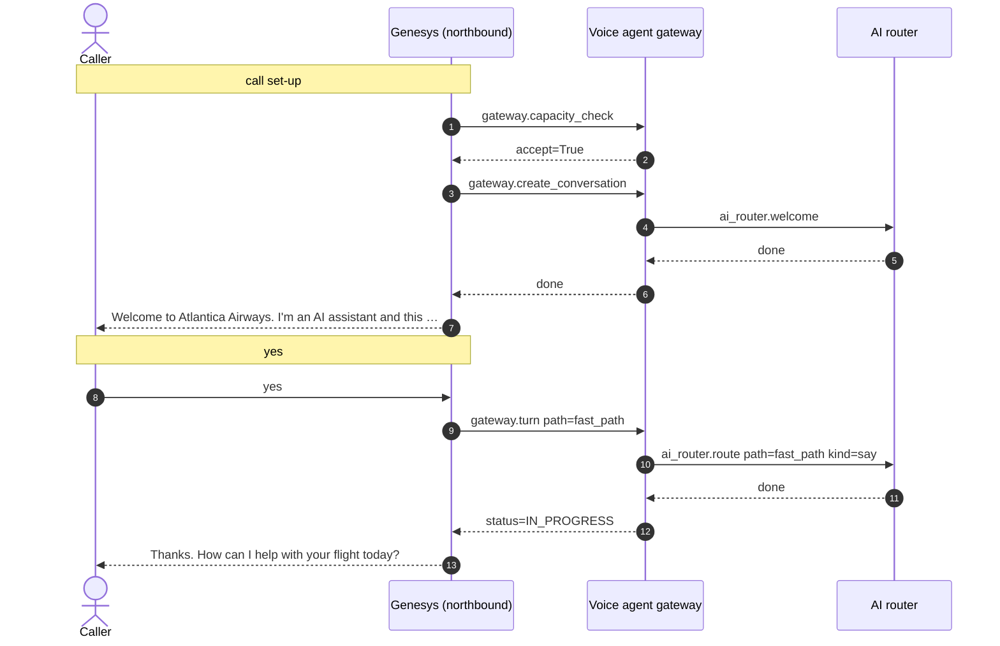
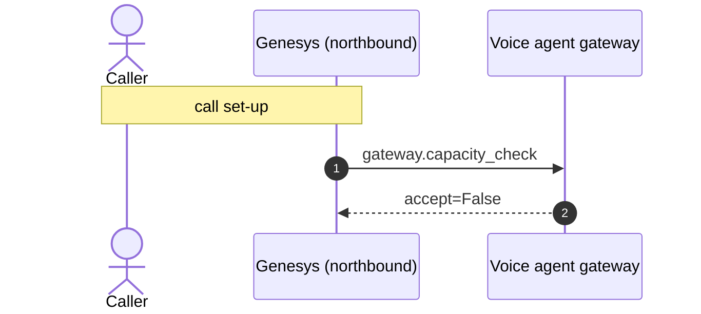

# Flow 11: Zingly at capacity, the next call overflows to a person

The tenant's concurrent-session ceiling is set to 1. The first call stays in the bot; the second is refused by the capacity check and Genesys queues it for a human with a callback.

**Demonstrates:** capacity check, overflow to human queue, no busy tone

**Result:** PASS · recorded 2026-10-11 17:48 · re-run with `python scripts/run_flow.py 11_capacity_full --trace`

## Setup

- reset PSS data, MCP lanes/saved copy/breaker, voice-agent sessions and lockouts
- atlantica max concurrent sessions = 1

## Call 1: +15550000201 dials +448000001234

Genesys routed the call to **zingly**.

| # | Caller | Bot | Path → agent | Identity | ms |
|---|---|---|---|---|---|
| 0 | *(dials)* | Welcome to Atlantica Airways. I'm an AI assistant and this call may be recorded. Is that OK? | welcome (pre-rendered) | unknown | |
| 1 | yes | Thanks. How can I help with your flight today? | fast_path | unknown | 0.4 |

### Sequence (built from the recorded spans)



### Traces

<details><summary>Call set-up</summary>

```text
[genesys] genesys: genesys.inbound_flow (12.1 ms) flow=Atlantica disruption line call_id=gen-fafbd0af81 caller=*********201 routed_to=zingly
  [voice-agent] gateway: gateway.capacity_check (3.5 ms) accept=True active=0 limit=1 breaker=closed
  [voice-agent] gateway: gateway.create_conversation (0.5 ms) call_id=gen-fafbd0af81 audio_id=atlantica:welcome:v1
    [voice-agent] ai-router: ai_router.welcome (0.3 ms)
```

</details>

<details><summary>Turn 1: “yes”</summary>

```text
[genesys] genesys: genesys.caller_turn (4.2 ms) call_id=gen-fafbd0af81 status=IN_PROGRESS
  [voice-agent] gateway: gateway.turn (0.4 ms) turn=1 status=IN_PROGRESS path=fast_path identity=unknown
    [voice-agent] channel: channel.inbound (0.0 ms) channel=text kind=speech chars=3
    [voice-agent] ai-router: ai_router.route (0.1 ms) kind=say path=fast_path
```

</details>

## Call 2: +15550000202 dials +448000001234

Genesys routed the call to **human_queue** (capacity check: at_capacity).

Queued for a person on **General_Support**, queued.

### Sequence (built from the recorded spans)



### Traces

<details><summary>Call set-up</summary>

```text
[genesys] genesys: genesys.inbound_flow (7.9 ms) flow=Atlantica disruption line call_id=gen-7eb1dbb1ef caller=*********202 routed_to=human_queue reason=capacity check: at_capacity
  [voice-agent] gateway: gateway.capacity_check (3.7 ms) accept=False active=1 limit=1 breaker=closed reasons=at_capacity
```

</details>

## Components involved

| Process | Component | Operations seen in this run |
|---|---|---|
| `genesys` | genesys | `genesys.caller_turn`, `genesys.inbound_flow` |
| `voice-agent` | ai-router | `ai_router.route`, `ai_router.welcome` |
| `voice-agent` | channel | `channel.inbound` |
| `voice-agent` | gateway | `gateway.capacity_check`, `gateway.create_conversation`, `gateway.turn` |

## Checks

- ✅ call 1: routed to zingly (got zingly)
- ✅ call 2: routed to human_queue (got human_queue)
- ✅ call 2: reason mentions at_capacity
