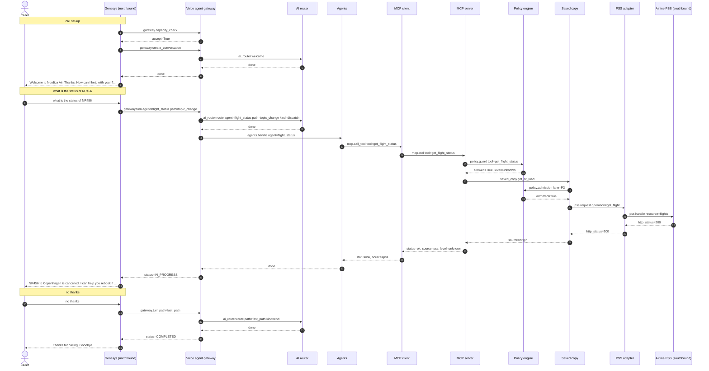
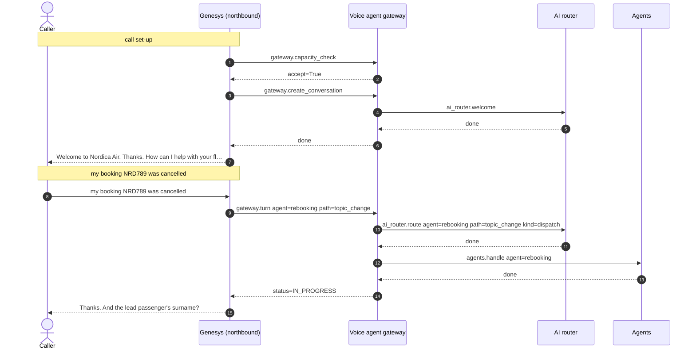

# Flow 12: Same deployment, second tenant

The Nordica line resolves to the Nordica tenant: its own welcome, no consent prompt, its own airports and reservation backend. Rebooking is canaried to 50% of Nordica calls, so the second call either verifies or is handed over as not_in_rollout.

**Demonstrates:** multi-tenancy from one config file, per-tenant rollout, tenant isolation

**Result:** PASS · recorded 2026-10-11 17:48 · re-run with `python scripts/run_flow.py 12_second_tenant_nordica --trace`

## Setup

- reset PSS data, MCP lanes/saved copy/breaker, voice-agent sessions and lockouts

## Call 1: +4791000001 dials +4780001234

Genesys routed the call to **zingly**.

| # | Caller | Bot | Path → agent | Identity | ms |
|---|---|---|---|---|---|
| 0 | *(dials)* | Welcome to Nordica Air. Thanks. How can I help with your flight today? | welcome (pre-rendered) | unknown | |
| 1 | what is the status of NR456 | NR456 to Copenhagen is cancelled. I can help you rebook if you like. Is there anything else I can help with? | topic_change → flight_status | unknown | 82.7 |
| 2 | no thanks | Thanks for calling. Goodbye. | fast_path | unknown | 0.3 |

### Sequence (built from the recorded spans)



### Traces

<details><summary>Call set-up</summary>

```text
[genesys] genesys: genesys.inbound_flow (11.9 ms) flow=Nordica customer line call_id=gen-d671bb8798 caller=********001 routed_to=zingly
  [voice-agent] gateway: gateway.capacity_check (3.4 ms) accept=True active=0 limit=500 breaker=closed
  [voice-agent] gateway: gateway.create_conversation (0.6 ms) call_id=gen-d671bb8798 audio_id=nordica:welcome:v1
    [voice-agent] ai-router: ai_router.welcome (0.4 ms)
```

</details>

<details><summary>Turn 1: “what is the status of NR456”</summary>

```text
[genesys] genesys: genesys.caller_turn (86.8 ms) call_id=gen-d671bb8798 status=IN_PROGRESS
  [voice-agent] gateway: gateway.turn (82.8 ms) turn=1 status=IN_PROGRESS path=topic_change agent=flight_status identity=unknown
    [voice-agent] channel: channel.inbound (0.0 ms) channel=text kind=speech chars=27
    [voice-agent] ai-router: ai_router.route (0.2 ms) kind=dispatch path=topic_change agent=flight_status
    [voice-agent] agents: agents.handle (82.0 ms) agent=flight_status done=True
      [voice-agent] mcp-client: mcp.call_tool (81.8 ms) tool=get_flight_status identity=none status=ok source=pss
        [mcp-server] mcp-server: mcp.tool (49.0 ms) tool=get_flight_status level=unknown status=ok source=pss
          [mcp-server] policy: policy.guard (0.0 ms) tool=get_flight_status level=unknown allowed=True
          [mcp-server] saved-copy: saved_copy.get_or_load (48.6 ms) key=flight source=origin
            [mcp-server] policy: policy.admission (0.0 ms) lane=P3 wait_budget_s=0.0 admitted=True waited_ms=0.0
            [mcp-server] pss-adapter: pss.request (48.2 ms) method=GET operation=get_flight http_status=200
              [airline-pss] airline-pss: pss.handle (44.4 ms) airline=nordica method=GET resource=flights http_status=200 limit_rps=5
```

</details>

<details><summary>Turn 2: “no thanks”</summary>

```text
[genesys] genesys: genesys.caller_turn (3.4 ms) call_id=gen-d671bb8798 status=COMPLETED
  [voice-agent] gateway: gateway.turn (0.3 ms) turn=2 status=COMPLETED path=fast_path identity=unknown
    [voice-agent] channel: channel.inbound (0.0 ms) channel=text kind=speech chars=9
    [voice-agent] ai-router: ai_router.route (0.1 ms) kind=end path=fast_path
```

</details>

## Call 2: +15550000301 dials +4780001234

Genesys routed the call to **zingly**.

| # | Caller | Bot | Path → agent | Identity | ms |
|---|---|---|---|---|---|
| 0 | *(dials)* | Welcome to Nordica Air. Thanks. How can I help with your flight today? | welcome (pre-rendered) | unknown | |
| 1 | my booking NRD789 was cancelled | Thanks. And the lead passenger's surname? | topic_change → rebooking | unknown | 0.4 |

### Sequence (built from the recorded spans)



### Traces

<details><summary>Call set-up</summary>

```text
[genesys] genesys: genesys.inbound_flow (8.8 ms) flow=Nordica customer line call_id=gen-7b681d94b0 caller=*********301 routed_to=zingly
  [voice-agent] gateway: gateway.capacity_check (2.6 ms) accept=True active=0 limit=500 breaker=closed
  [voice-agent] gateway: gateway.create_conversation (0.4 ms) call_id=gen-7b681d94b0 audio_id=nordica:welcome:v1
    [voice-agent] ai-router: ai_router.welcome (0.2 ms)
```

</details>

<details><summary>Turn 1: “my booking NRD789 was cancelled”</summary>

```text
[genesys] genesys: genesys.caller_turn (3.5 ms) call_id=gen-7b681d94b0 status=IN_PROGRESS
  [voice-agent] gateway: gateway.turn (0.5 ms) turn=1 status=IN_PROGRESS path=topic_change agent=rebooking identity=unknown
    [voice-agent] channel: channel.inbound (0.0 ms) channel=text kind=speech chars=31
    [voice-agent] ai-router: ai_router.route (0.1 ms) kind=dispatch path=topic_change agent=rebooking
    [voice-agent] agents: agents.handle (0.0 ms) agent=rebooking next_question=surname
```

</details>

## Components involved

| Process | Component | Operations seen in this run |
|---|---|---|
| `airline-pss` | airline-pss | `pss.handle` |
| `genesys` | genesys | `genesys.caller_turn`, `genesys.inbound_flow` |
| `mcp-server` | mcp-server | `mcp.tool` |
| `mcp-server` | policy | `policy.admission`, `policy.guard` |
| `mcp-server` | pss-adapter | `pss.request` |
| `mcp-server` | saved-copy | `saved_copy.get_or_load` |
| `voice-agent` | agents | `agents.handle` |
| `voice-agent` | ai-router | `ai_router.route`, `ai_router.welcome` |
| `voice-agent` | channel | `channel.inbound` |
| `voice-agent` | gateway | `gateway.capacity_check`, `gateway.create_conversation`, `gateway.turn` |
| `voice-agent` | mcp-client | `mcp.call_tool` |

## Checks

- ✅ call 1: routed to zingly (got zingly)
- ✅ call 1: welcome 'Welcome to Nordica Air'
- ✅ call 1 turn 1: reply contains 'NR456 to Copenhagen is cancelled'
- ✅ call 1 turn 2: call status COMPLETED (got COMPLETED)
- ✅ call 2: routed to zingly (got zingly)
- ✅ call 2 turn 1: reply contains one of ['surname', 'colleague']
