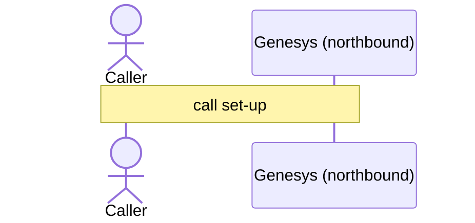

# Flow 13: Genesys A/B split sends the call to the legacy IVR

The bot share of the inbound flow is set to 0%, so Genesys never calls Zingly.

**Demonstrates:** A/B rollout owned by Genesys

**Result:** PASS · recorded 2026-10-11 17:48 · re-run with `python scripts/run_flow.py 13_ab_split_legacy_ivr --trace`

## Setup

- reset PSS data, MCP lanes/saved copy/breaker, voice-agent sessions and lockouts
- Genesys inbound flow +448000001234: 0% to the bot

## Conversation

Genesys routed the call to **legacy_ivr** (A/B split (0% to bot)).

### Sequence (built from the recorded spans)



### Traces

<details><summary>Call set-up</summary>

```text
[genesys] genesys: genesys.inbound_flow (0.0 ms) flow=Atlantica disruption line call_id=gen-febfd69609 caller=*********401 routed_to=legacy_ivr
```

</details>

## Components involved

| Process | Component | Operations seen in this run |
|---|---|---|
| `genesys` | genesys | `genesys.inbound_flow` |

## Checks

- ✅ call 1: routed to legacy_ivr (got legacy_ivr)
